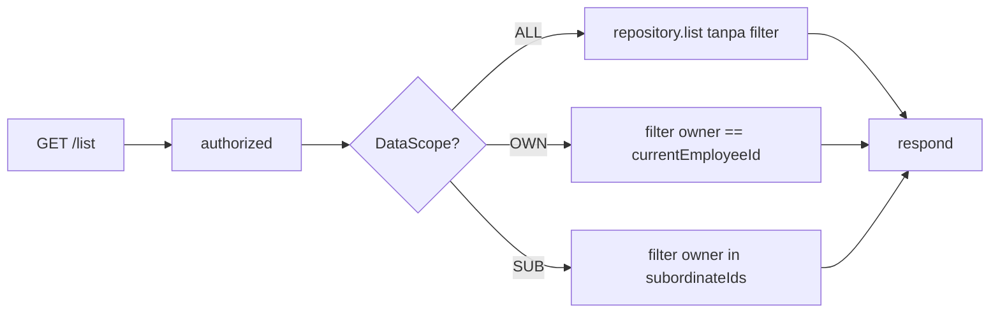

# TRD-FIELD-004-Q4: DataScope Filtering untuk Modul Generate CRUD

## 1. Document Context and Administration

- **Title & ID**: TRD-FIELD-004-Q4 — DataScope Filtering untuk Rute CRUD Modul Hasil Generate
- **Status**: **Draft**
- **Basis**: `main` @ `e1ac720` (setelah merge TRD-FIELD-004 Track A+B+C)
- **Dokumen terkait**: `TRD-FIELD-004-file-relation-server-hardening.md` §2 Q4, `SpecRoutesWriter.kt:89`

### Revision History

| Versi | Tanggal | Penulis | Catatan |
| :--- | :--- | :--- | :--- |
| 0.1 | 2026-10-11 | Claude Sonnet 5.5 | Draft awal dari analisis Q4 |

### Summary & Business Context

**Masalah**: Rute CRUD yang digenerate oleh `SpecRoutesWriter` melakukan `repository.list(tenant.tenantId)` tanpa filter DataScope. Untuk modul dengan `ScopeCapability.HIERARCHICAL`, pengguna dengan `OWN_DATA_ONLY` atau `SUBORDINATE_DATA` seharusnya hanya melihat record miliknya atau bawahannya, tetapi saat ini melihat **semua record** di tenant.

**Referensi kode bermasalah**:
```kotlin
// SpecRoutesWriter.kt:89
call.respondText(jsonArrayOf(repository.list(tenant.tenantId).map(::rowJson)).encode(), ...)
```

**Solusi yang disarankan di TRD-FIELD-004**: Tiket terpisah. Sementara generator menolak pack HIERARCHICAL.

### Stakeholders & Approvers

Product/pemilik platform, Tech Lead (RBAC/guard/generator), QA (probe 403 & isolasi), Developer pelaksana.

### Goals (In-Scope)

- G1: Rute GET `/list` pada modul hasil generate memfilter berdasarkan DataScope pemanggil
- G2: Repository prototype support filtering by owner IDs
- G3: Workaround sementara: generator menolak pack HIERARCHICAL sampai solusi selesai
- G4: Tes penjaga yang mendeteksi Drift jika filter DataScope hilang

### Non-Goals (Out-of-Scope)

- Mengubah modul non-generate (CRM, Deal, dll) — sudah ada polanya
- DataScope untuk FILE/RELATION field — sudah ditangani Track A
- Migrasi data untuk owner baru

---

## 2. Functional Requirements

### 2.1 Audit Masalah (dari TRD-FIELD-004 Q4)

| Lokasi | Masalah |
| :-- | :-- |
| `SpecRoutesWriter.kt:89` | `repository.list(tenant.tenantId)` tanpa filter DataScope |
| `PrototypeRowRepository.kt:12` | Interface `list(tenantId)` tidak terima parameter owner/filter |
| `SpecPostgresWriter.kt` | Repository generate tidak emit kolom `owner_id` |

**Dampak**: Pengguna `OWN_DATA_ONLY` di modul HIERARCHICAL melihat record orang lain.

### 2.2 Solusi Arsitektur

**Pendekatan A — Filter di memori (sederhana)**:
1. Repository mengembalikan semua row + owner info
2. Route filtering berdasarkan `reachableOwnerIds`
3. Tidak perlu perubahan interface repository

**Pendekatan B — Repository filter (lebih scalable)**:
1. Tambah method `list(tenantId, ownerIds: Set<String>?)` ke interface
2. null = semua, empty set = hanya tanpa owner, set = filter by owners
3. Generator emit kolom `owner_id`

**Keputusan**: Pendekatan A untuk v1 (lebih sederhana, tidak perlu migrasi schema), dengan catatan di KDoc bahwa solusi B untuk tabel besar.

### 2.3 Persyaratan

- **FR-1** Generator menolak pack HIERARCHICAL sampai fix selesai (workaround, sudah ada di KDoc)
- **FR-2** Tambahkan `owner: String?` ke `PrototypeRow` (core domain)
- **FR-3** Repository generate emit kolom `owner_id` nullable
- **FR-4** GET `/list` route filter berdasarkan `decision.config.sanitizeFor(module).scope`:
  - `ALL_TENANT_DATA` → tanpa filter
  - `OWN_DATA_ONLY` → filter `owner == currentEmployeeId`
  - `SUBORDINATE_DATA` → filter `owner in subordinateEmployeeIds`
- **FR-5** POST tidak perlu owner (d set saat save)
- **FR-6** PUT/DELETE tetap bisa akses record apapun (sudah di-handle RBAC lain)

---

## 3. Non-Functional Requirements (NFRs)

| Kategori | Persyaratan | Catatan |
| :-- | :-- | :-- |
| Security | Tidak ada data leak lintas scope | Verifikasi via tes |
| Performance | Filter di memori untuk tabel kecil | Untuk besar, perlu solusi B |
| Maintainability | KDoc jelas di SpecRoutesWriter | Workaround sementara |
| Compatibility | Golden test generator tetap hijau | Untuk spec non-HIERARCHICAL |

---

## 4. System Architecture & Technical Design

### 4.1 Arsitektur



### 4.2 Komponen

- `core/.../domain/prototype/PrototypeRow.kt`: tambah `owner: String?`
- `core/.../domain/discovery/handoff/SpecPostgresWriter.kt`: emit `owner_id` column
- `core/.../domain/discovery/handoff/SpecRoutesWriter.kt`: filter by scope di GET `/list`
- `SpecScaffoldGenerator.kt`: generator menolak HIERARCHICAL pack sementara

### 4.3 Estimasi File

| File | Sekarang | Setelah |
| :-- | :-- | :-- |
| `PrototypeRow.kt` | ~30 | +5 baris |
| `SpecRoutesWriter.kt` | 201 | +30 baris filter |
| `SpecPostgresWriter.kt` | ~100 | +10 baris |

---

## 5. Testing, Deployment, and Operations

### Technical Acceptance Criteria

- AC1: GET `/list` dengan OWN_DATA_ONLY hanya return record miliknya
- AC2: GET `/list` dengan SUBORDINATE_DATA return miliknya + subordinates
- AC3: GET `/list` dengan ALL_TENANT_DATA return semua
- AC4: Tes drift: generator untuk HIERARCHICAL pack ditolak

### Testing Strategy

1. Unit test untuk filter logic di SpecRoutesWriterTest
2. Integration test dengan dua employee + different scopes
3. Golden test: spec tanpa HIERARCHical tidak berubah

### Parallel Execution Plan

- **Track A — Core**: PrototypeRow + interface
- **Track B — Generator**: PostgresWriter + RoutesWriter filter
- **Track C — Guard**: Test untuk deteksi drift

### Effort Estimation

- **Rating**: Medium
- **Reasoning**: Sentuh generator + routes + domain; tidak ada migrasi data; sudah ada pola serupa di CRM routes
