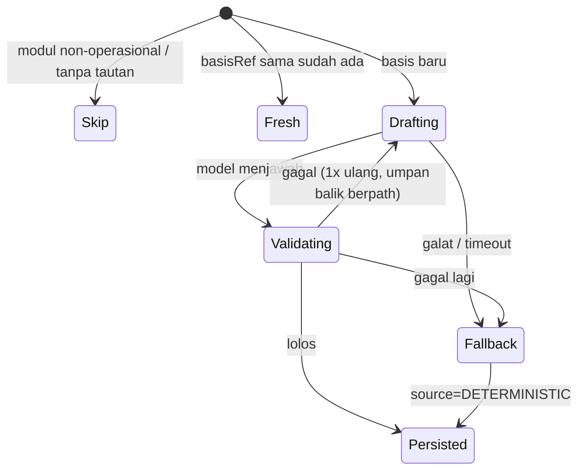
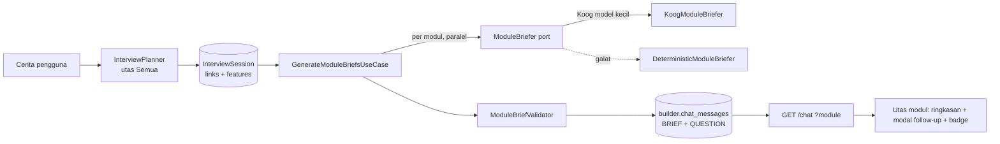

# TRD-BLDR-001: Ringkasan & Follow-Up per Modul di Chat Builder (Module Briefs)

## 1. Document Context and Administration

- **ID**: TRD-BLDR-001
- **Status**: **Diusulkan** (2026-10-14)
- **Rencana**: [`PLAN-builder-module-briefs.md`](../../plannings/features/PLAN-builder-module-briefs.md)
- **Rujukan**: [`PLAN-builder-interview-chat.md`](../../plannings/features/PLAN-builder-interview-chat.md),
  [`TRD-K3`](../mvp/TRD-K3-builder-wizard-followup-ui.md), `tenant-variability-rules.md`, `module-integration-rules.md` §5

### Revision History
| Versi | Tanggal | Penulis | Catatan |
|---|---|---|---|
| 0.1 | 2026-10-14 | Claude (atas permintaan pemilik) | Draf awal |
| 0.2 | 2026-10-14 | Claude | Keluaran brief = ringkasan + **Tahap berurutan** (bukan hanya daftar fitur). Skenario lintas modul dipindah ke [TRD-BLDR-002](TRD-BLDR-002-scenario-simulation.md) |

### Summary & Business Context

Setelah pengguna menceritakan alur aplikasinya, chat Builder sudah punya utas per modul (`ChatMessage.moduleId`)
dan follow-up per modul. Namun (verifikasi kode 2026-10-14):

| Kemampuan | Kondisi |
|---|---|
| Riwayat chat per modul | Ada (`inThread`) |
| Follow-up per modul | Ada, tapi **template tetap** dari `ModuleGapAnalyzer` (5 jenis celah, maks 3), tanpa AI, tidak menyebut isi cerita |
| AI menafsirkan chat modul → sunting isian | Ada (`EditModuleFromChat` / `ModuleEditor`) |
| AI perencana wawancara (utas Semua) → divisi/peran/tautan modul + `RoleModuleLink.features` | Ada, tapi hasilnya hanya masuk `InterviewSession`, **tidak tampil sebagai pesan di utas modul** |
| **Ringkasan per modul hasil AI** (apa yang dilakukan modul ini + fitur-fiturnya) | **Tidak ada** |
| **Follow-up kontekstual per modul dari AI** | **Tidak ada** |

Akibatnya pengguna yang membuka tab modul melihat utas kosong (kini diisi ringkasan lokal sementara dari data draf
di `openingEntryForModule`, bukan hasil AI) dan pertanyaan generik.

### Stakeholders
Product (pemilik), Tech Lead, Developer Builder, QA.

### Goals (In-Scope)
1. Setelah rencana wawancara terbentuk, tiap modul **operasional aktif** mendapat satu pesan **BRIEF** di utasnya:
   ringkasan peran modul dalam alur pengguna + daftar fitur.
2. Tiap BRIEF memuat **Tahap berurutan** (sketsa alur satu dokumen di dalam modul; langkah opsional dan loop rework
   ditandai) — itulah "flow kecil" modul, mis. Sampling: Intake → Desain → Pola → Jahit sampel → Revisi → Approval.
3. Tiap modul mendapat **follow-up kontekstual** (maks 3) yang merujuk isi cerita, disimpan sebagai pesan QUESTION
   di utas modul itu, dengan badge hitungan yang sudah benar sejak awal.
4. Pembuatan **idempoten** dan **tidak pernah gagal karena AI**: galat/timeout/keluaran tak sah → brief deterministik
   dari data draf (`RoleModuleLink.features` + `ModuleGapAnalyzer`).
5. Brief diperbarui bila basisnya berubah (cerita/tautan), tanpa menggandakan pesan lama.
6. Fungsi berlaku untuk **semua pack** (garment dan non-garment); tidak ada kosakata satu industri di kode mesin.

### Non-Goals
- Mengubah draf secara otomatis dari brief (draf tetap hanya berubah lewat **Terapkan**, plan §4).
- Menyimpan Tahap hasil brief sebagai `TenantStageFlow`. Verifikasi 2026-10-14: `TenantStageFlow`/`IndustryTemplateCode`
  terikat ke alur sampling (KDoc: "kerangka tahap alur sampling"), jadi **tidak dipakai ulang** untuk pack hasil generate.
  Tahap di brief adalah **sketsa deskriptif** (`StageSketch`); mempromosikannya menjadi kerangka tahap generik adalah
  pekerjaan terpisah.
- Skenario lintas modul dan simulasi layar (→ TRD-BLDR-002).
- Menyimpan "fitur" sebagai entitas domain baru (fitur modul tetap turunan: layar + port + butir brief).
- Menulis ulang `EditModuleFromChat` atau `InterviewPlanner`.
- Brief untuk modul GOVERNANCE/FOUNDATION (tidak punya layar berproposal; sama seperti `ModuleGapAnalyzer`).

---

## 2. Functional Requirements

**FR-1 — Pemicu.** Brief dibuat (a) setelah `InterviewSession` berstatus `isPlanned` pertama kali, (b) setelah
putaran klarifikasi utas Semua dijawab dan rencana dihitung ulang, (c) sesuai permintaan eksplisit
`POST /api/builder/chat/briefs` (mis. tombol "Segarkan ringkasan", Track C).

**FR-2 — Cakupan.** Modul = modul aktif draf dengan `kind == OPERATIONAL` yang punya ≥1 `RoleModuleLink`
atau layar berproposal. Modul tanpa keduanya dilewati (bukan galat).

**FR-3 — Masukan ke model.** Narasi cerita, nama modul (data pack), peran & fitur dari `RoleModuleLink`, port
masuk/keluar slot, isian layar yang ada, dan pertanyaan yang **sudah pernah ditanyakan/dijawab** di utas modul.

**FR-4 — Keluaran model (tidak tepercaya).** `ModuleBrief(summary, features[], stages[], followUps[])`. Divalidasi:

| Aturan | Batas |
|---|---|
| `summary` tidak kosong | ≤ 600 karakter |
| `features` | 1–8 butir, tiap butir ≤ 80 karakter, tanpa duplikat (case-insens.) |
| `stages` | 0–7 `StageSketch(name ≤ 40, optional, reworkTo?)`; nama unik; `reworkTo` harus nama tahap **sebelumnya**; lebih dari 7 → minta kelompokkan (drill-down), bukan dipotong diam-diam |
| `followUps` | 0–3, tiap butir ≤ 160 karakter dan berakhiran `?` |
| Duplikat pertanyaan | pertanyaan yang setara (dinormalisasi) dengan yang sudah ada di utas dibuang |

Keluaran gagal validasi = satu percobaan ulang dengan umpan balik berpath (pola `EditModuleFromChat`), lalu
**fallback deterministik** (FR-6). Tidak ada fallback senyap yang mengubah data: pesan fallback ditandai
`source = DETERMINISTIC` agar terlihat.

**FR-5 — Persistensi.** Brief = `ChatMessage` baru `kind = BRIEF`, `role = AGENT`, `moduleId` = modul, `text` = ringkasan,
`features` = butir fitur (pelengkap kecil yang **bukan** kotak flow), `stages` = `StageSketch` berurutan, `basisRef` = hash(narasi + fitur tautan + versi agent). Follow-up = pesan `QUESTION` biasa
(mekanik K3 yang sudah ada), `Clarification.id` = `ai:<moduleId>:<hash-teks>` agar stabil.

**FR-6 — Fallback deterministik.** Ringkasan dirakit dari `RoleModuleLink.features` + nama modul (`stages` kosong — jujur, tidak dikarang); follow-up dari
`ModuleGapAnalyzer.analyze` (perilaku saat ini). Total follow-up per modul tetap ≤ 3 (AI diprioritaskan, celah mengisi sisa).

**FR-7 — Idempoten & pembaruan.** Bila sudah ada BRIEF dengan `basisRef` sama → tidak melakukan apa pun. Basis
berubah → pesan BRIEF baru ditambahkan (riwayat tidak dihapus); klien menampilkan BRIEF **terbaru** per modul dengan
yang lama dilipat. Follow-up yang sudah dijawab tidak pernah ditanyakan ulang.

**FR-8 — Utas.** BRIEF dan QUESTION hanya muncul di utas modulnya dan di utas Semua (tanpa filter, K4). Modal
follow-up utas modul hanya memuat pertanyaan modul itu (perbaikan 2026-10-14 di `BuilderChatPane`).

**FR-9 — Badge sejak awal.** Hitungan follow-up semua modul tersedia dari `GET /chat` utas Semua
(dikelompokkan per `moduleId`); klien tidak perlu membuka tiap modul.

**FR-10 — Progres.** Run mengirim SSE `module_started`/`module_ready` (sudah dikenal klien) per modul; kegagalan satu
modul tidak menghentikan modul lain.

State machine pembuatan brief per modul:



---

## 3. Non-Functional Requirements

| Category | Requirement & Target Metrics | Rationale / Mitigation |
| :--- | :--- | :--- |
| **Performance** | Brief ≤ 9 modul dihasilkan paralel (konkurensi 3); p95 total ≤ 45 dtk; run tidak memblokir UI (SSE) | Model kecil per modul, bukan satu prompt raksasa |
| **Scalability** | Prompt per modul ≤ 6k token; ≤ 1 BRIEF aktif per modul | Hindari narasi penuh berulang: kirim ringkasan narasi + potongan relevan bila > batas |
| **Security** | Endpoint di balik gerbang `MANAGE_BUILDER` fail-closed; run tenant lain = 404; narasi diperlakukan sebagai **data** (bukan instruksi), keluaran divalidasi dan tidak pernah menulis draf | Mitigasi prompt-injection: model hanya mengusulkan teks; validator + panjang batas |
| **Availability & Reliability** | AI mati ⇒ brief deterministik; satu modul gagal tak menghentikan lainnya; idempoten | "Wawancara tidak pernah gagal karena AI" (prinsip `InterviewPlanner`) |
| **Maintainability & Observability** | Port `ModuleBriefer` di domain; implementasi Koog di server; log terstruktur `tenant, module, source, attempts, durationMs`; metrik rasio fallback | Mutu AI terukur: rasio `DETERMINISTIC` tinggi = sinyal masalah |
| **Tenant isolation** | Tabel `builder.chat_messages` sudah RLS per tenant; tidak ada tabel baru | Kontrak 7 module-integration |

---

## 4. System Architecture & Technical Design

### High-Level Architecture



### Detailed Component Design

| Lapisan | Artefak | Catatan |
|---|---|---|
| core/domain/builder | `ChatMessageKind.BRIEF` (enum sah: mekanik platform) | Uji Variabilitas lolos — bukan konsep industri |
| | `ChatMessage.features: List<String>`, `basisRef: String?` | `init`: features hanya untuk BRIEF |
| | `ModuleBrief`, `StageSketch`, `BriefSource {AI, DETERMINISTIC}` | value object murni; `StageSketch` deskriptif, bukan agregat persisten |
| | `fun interface ModuleBriefer { suspend fun brief(req: ModuleBriefRequest): Result<ModuleBrief> }` | pola `ModuleEditor` |
| | `ModuleBriefValidator` | aturan FR-4, berpath |
| | `DeterministicModuleBriefer` | FR-6, murni, aman bila peran/tautan tak ada |
| core/application | `GenerateModuleBriefsUseCase(chats, drafts, briefer, clock)` | idempoten (FR-7); `Result<List<ModuleBriefOutcome>>` |
| server/infrastructure/builder | `KoogModuleBriefer` + prompt | model kecil; jawaban JSON ketat; parser tunggal menolak bentuk tak dikenal |
| server/routes | `POST /api/builder/chat/briefs` `{module?}` | tanpa `module` = semua modul; didaftarkan di `BuilderRoutes`/wiring yang sama |
| server/infrastructure | `PostgresBuilderChatRepository`: kolom baru, kind BRIEF | |
| app/shared | `ChatModel` (parse `BRIEF`, `features`), `ChatMessageBubble` varian ringkasan, `openingEntryForModule` dipertahankan hanya sebagai kosong-state | desain clay, token, nol literal warna |

Penghapusan: `AskModuleFollowUpsUseCase` **tidak dihapus** — ia menjadi pengisi sisa kuota follow-up (FR-6) dan jalur
pembuka tab bagi modul yang belum punya brief.

### Data Model & Schema

Migrasi aditif (nomor = berikutnya setelah `V104`; cek `ls | sort -V` saat implementasi), pola V93:

```sql
ALTER TABLE builder.chat_messages ADD COLUMN IF NOT EXISTS features  TEXT NOT NULL DEFAULT '[]';
ALTER TABLE builder.chat_messages ADD COLUMN IF NOT EXISTS stages    TEXT NOT NULL DEFAULT '[]'; -- [{name, optional, reworkTo?}]
ALTER TABLE builder.chat_messages ADD COLUMN IF NOT EXISTS basis_ref VARCHAR(80) NULL;
ALTER TABLE builder.chat_messages ADD COLUMN IF NOT EXISTS brief_source VARCHAR(16) NULL; -- AI | DETERMINISTIC
ALTER TABLE builder.chat_messages DROP CONSTRAINT IF EXISTS chat_messages_kind_check;
ALTER TABLE builder.chat_messages
  ADD CONSTRAINT chat_messages_kind_check CHECK (kind IN ('TEXT','QUESTION','BRIEF'));
CREATE INDEX IF NOT EXISTS idx_builder_chat_messages_brief
  ON builder.chat_messages (conversation_id, module_id, kind, created_at) WHERE kind = 'BRIEF';
```
Pesan lama tetap terbaca persis seperti sebelumnya (default `'[]'`, kolom nullable).

### API Specifications

| Endpoint | Request | Respons | Galat |
|---|---|---|---|
| `POST /api/builder/chat/briefs` | `{"module": "<id>"?}` | `200 {"results":[{"moduleId","status":"created\|fresh\|skipped","source":"AI\|DETERMINISTIC"}]}` | 403 tak berwenang (fail-closed), 400 modul tak dikenal, 409 run aktif |
| `GET /api/builder/chat?module=` | — | pesan memuat `kind:"BRIEF"`, `features[]`, `stages[]`, `briefSource` | — |

### Technology Usage & Tradeoff
- **Satu panggilan model per modul** (bukan satu prompt untuk semua): prompt kecil, kegagalan terisolasi, bisa paralel.
  Ongkos: lebih banyak panggilan — dibatasi konkurensi 3 dan idempotensi.
- **BRIEF sebagai `ChatMessage`** (bukan tabel baru): memakai RLS, riwayat, utas, dan API yang sudah ada. Ongkos: satu kolom
  JSON `features`; pengganti bila tumbuh = tabel `module_briefs` (di luar cakupan).
- **Model hanya mengusulkan teks**, validator domain yang menentukan — sejalan dengan semua agent Builder.

### Assumptions, Constraints, Dependencies
- Rencana wawancara (`InterviewPlanner`) tersedia; tanpa itu brief jatuh ke fallback dari draf.
- Model kecil Koog yang dipakai `KoogModuleEditor` dapat dipakai ulang (konfigurasi sama).
- Batas ukuran file (CLAUDE.md §14): `BuilderChatUseCases.kt` (218) dan `BuilderChatPane.kt` (363) — penambahan logika
  masuk file baru; `BuilderChatPane` tidak boleh melewati 400.

---

## 5. Testing, Deployment, and Operations

### Effort Estimation & Reasoning
- **Rating**: `Medium`.
- **Reasoning**: satu migrasi aditif, satu port + use case + validator di core, satu implementasi Koog + satu rute di server,
  perubahan terbatas di klien (parse + bubble). Tidak ada perubahan RBAC/modul baru. Risiko utama: mutu prompt dan
  konsistensi idempotensi. Estimasi 3–4 hari kerja.

### Parallel Execution Plan (Tracks)
- **Track 0 — Contract Phase (serial)**: bekukan `ModuleBrief`, `ModuleBriefer`, `ChatMessageKind.BRIEF`, bentuk JSON
  `BRIEF` di `GET /chat`, DTO `POST /briefs`, fixture JSON di `commonTest/resources`.
- **Track A — Core & Domain**: validator, `DeterministicModuleBriefer`, `GenerateModuleBriefsUseCase`, test paritas
  (iterasi `ChatMessageKind.entries`).
- **Track B — Server & Persistence**: migrasi, repository, `KoogModuleBriefer` + parser tunggal, rute, test 403, pemicu
  dari `SendBuilderMessageUseCase` setelah rencana.
- **Track C — Client & UI**: parse BRIEF, bubble ringkasan (lipat versi lama), tombol "Segarkan ringkasan", test unit parser.
- **Track D — Visual Check**: tenant `wemade-demo` (superadmin demo) dan `bordir-uji` pada ~1280dp; utas Semua vs modul;
  badge sejak awal; AI mati (fallback) terlihat berbeda lewat `briefSource`.

### Technical Acceptance Criteria
- [ ] AC-1: setelah cerita + rencana, tiap modul operasional aktif punya tepat 1 BRIEF aktif di utasnya.
- [ ] AC-2: memanggil ulang pembuat brief dengan basis sama **tidak** menambah pesan.
- [ ] AC-3: basis berubah → BRIEF baru; jawaban follow-up lama tidak ditanyakan ulang.
- [ ] AC-4: keluaran model tak sah (kosong, >batas, tanpa `?`) ditolak; setelah 2 kali gagal → fallback `DETERMINISTIC`.
- [ ] AC-5: model melempar galat/timeout → run tetap sukses dengan brief deterministik.
- [ ] AC-6: badge setiap tab modul benar tepat setelah memuat halaman, tanpa membuka tab.
- [ ] AC-7: pengguna tanpa `MANAGE_BUILDER` → 403 pada `POST /briefs`; tenant lain tidak melihat/memicu apa pun.
- [ ] AC-8a: `stages` tak sah (>7, `reworkTo` ke tahap setelahnya, nama ganda) ditolak; fallback menghasilkan `stages` kosong, bukan karangan.
- [ ] AC-8: tenant uji non-garment (`bordir-uji`) menghasilkan brief tanpa istilah garment di kode mesin.

### Testing Strategy
- **Unit (core)**: validator (tiap aturan FR-4, berpath), deterministik (peran tak ada → aman), use case dengan fake
  `ModuleBriefer` (sukses, gagal-lalu-sukses, gagal total, idempoten, basis berubah) memakai **template non-default**.
- **Integrasi (server)**: repository Postgres (kolom baru, constraint, backfill pesan lama); rute 403/400/409.
- **Parser**: bentuk JSON tak dikenal ditolak (bukan jatuh ke default).
- **Evaluasi agent**: set cerita tetap (garment + non-garment) dengan model tiruan deterministik; tanpa LLM berbayar di CI.
- **UI**: test parser/ViewModel; cek mata Track D.

### Monitoring & Error Handling
Log `module_brief{tenant,module,source,attempts,durationMs}`; hitung rasio fallback; galat model = `warn`, bukan 500;
SSE `error` hanya untuk galat run, bukan galat per-modul (diganti `module_ready` dengan `source`).

### Deployment & Rollback
- Migrasi aditif + constraint diperlebar: aman dijalankan sebelum kode baru.
- Fitur di belakang flag konfigurasi server `builder.moduleBriefs.enabled` (default off → on setelah Track D).
- Rollback: matikan flag (klien mengabaikan `BRIEF` bila tak dikenal → ditolak parser dengan pesan jelas, jadi klien dan
  server dirilis bersamaan); data BRIEF yang sudah ada tidak berbahaya. Migrasi tidak perlu dibalik.
