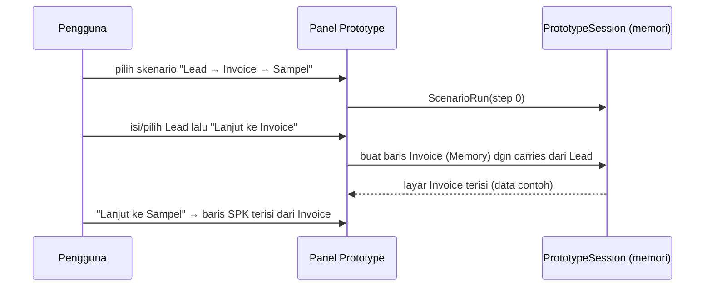
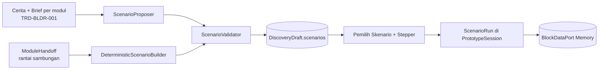

# TRD-BLDR-002: Skenario Lintas Modul & Simulasi Prototype

## 1. Document Context and Administration

- **ID**: TRD-BLDR-002
- **Status**: **Diusulkan** (2026-10-14)
- **Bergantung pada**: [`TRD-BLDR-001`](TRD-BLDR-001-module-briefs.md) (brief & Tahap per modul)
- **Rencana**: [`PLAN-builder-module-briefs.md`](../../plannings/features/PLAN-builder-module-briefs.md) Fase 2
- **Rujukan**: `PLAN-prototype-data-port-rich-blocks.md`, `domain/prototype/BlockDataPort.kt`, `PrototypeSession.kt`

| Versi | Tanggal | Penulis | Catatan |
|---|---|---|---|
| 0.1 | 2026-10-14 | Claude (atas permintaan pemilik) | Draf awal |

### Summary & Business Context

Prototype sekarang disusun **per modul** (satu usulan layar per modul). Pengguna melihat "layar Lead", "layar Invoice",
"layar Sampling" terpisah, padahal yang ingin divalidasi adalah cerita: *"lead jadi invoice, invoice jadi pesanan
sampel"*. Diperlukan **skenario**: jalur bisnis ujung ke ujung yang melintasi beberapa modul, dengan layar prototype
tiap langkah yang saling tersambung.

**Keputusan pemilik (2026-10-14): simulasi tampilan.** Data yang terbawa antar layar adalah data contoh di memori sesi;
**tidak disimpan ke server** dan tidak membuat record sungguhan.

### Verifikasi kondisi kini (2026-10-14)
| Hal | Kondisi |
|---|---|
| Sesi prototype bersama semua layar | **Ada** — `PrototypeSession`, data bersama per draf; dasbor sudah membaca baris layar lain |
| Binding data | `DataBinding.Memory` (bawaan) / `Api`; simulasi memakai `Memory` |
| Referensi antar modul | `FieldType.RELATION` target `"modul:entitas"` (dipakai server modul hasil generate) |
| Aksi "bawa data dari layar A ke layar B" | **Belum ada** |
| Penyimpanan konsep skenario di draf | **Belum ada** (`DiscoveryDraft` hanya layar + sambungan antar modul) |
| Sambungan antar modul (`ModuleHandoff`: dari, ke, tipe port) | **Ada** di sesi wawancara — dasar untuk skenario deterministik |

### Goals (In-Scope)
1. Konsep **`ScenarioSketch`** di draf: judul + langkah berurutan; tiap langkah = modul, layar, dan pemetaan field yang dibawa.
2. AI mengusulkan **1–3 skenario utama** dari cerita + brief; pengguna mengonfirmasi/menolak (tidak otomatis aktif).
3. **Pemutar skenario** di prototype: tombol aksi pada langkah membuat baris di layar langkah berikutnya, terisi dari baris
   asal (simulasi memori), lalu berpindah layar.
4. Fallback deterministik: skenario dirakit dari rantai `ModuleHandoff`, pemetaan field dari kecocokan kunci/label.
5. Pertanyaan tingkat skenario di utas Semua (mis. "Invoice dibuat sebelum atau sesudah sampel dikerjakan?").

### Non-Goals
- Menyimpan record sungguhan atau memanggil API modul (itu jalur `DataBinding.Api`, di luar cakupan).
- Alur bercabang kompleks (skenario = jalur linear dengan paling banyak satu loop rework yang dideklarasikan).
- Menggantikan layar per modul; skenario **menyusun** layar yang sudah ada.
- Mengubah modul live (CRM, Sampling, operator).
- Mengubah draf otomatis dari skenario (draf hanya berubah lewat **Terapkan**).

---

## 2. Functional Requirements

**FR-1 — Model.**
```
ScenarioSketch(id, title, steps: List<ScenarioStep>, source: AI | DETERMINISTIC | USER, confirmed: Boolean)
ScenarioStep(moduleId, screenId?, label, carries: List<FieldCarry>, reworkTo: Int? = null)
FieldCarry(fromField, toField)          // kunci field di layar langkah ini → layar langkah berikutnya
```
`screenId == null` berarti modul belum punya layar berproposal → langkah ditampilkan sebagai **kerangka** (pola
`SkeletonBlock`, `field-component-rules.md` Kontrak 8), tidak dipalsukan.

**FR-2 — Validasi (berpath, domain).** Tolak bila: langkah 1 > 7; `moduleId` bukan modul aktif; `screenId` bukan layar modul
itu; `FieldCarry.fromField`/`toField` tak ada di entitas layar terkait; tipe field tak kompatibel (aturan koersi yang
sama dengan `FieldTypeConversion`); `reworkTo` bukan langkah sebelumnya; skenario ganda (urutan modul sama). Judul ≤ 80
karakter. Nilai tak dikenal **ditolak**, tidak jatuh ke default (Kontrak 4 variabilitas).

**FR-3 — Pengusul.** Port `ScenarioProposer.propose(narrative, briefs, handoffs, screens): Result<List<ScenarioSketch>>`;
maksimal 3; keluaran tak tepercaya → validator → 1x ulang dengan umpan balik berpath → fallback FR-4. Tidak ada skenario
valid → **daftar kosong yang jujur** (UI menampilkan "belum ada skenario"), bukan karangan.

**FR-4 — Fallback deterministik.** Jalur terpanjang dari modul masuk menurut `ModuleHandoff` terkonfirmasi/tebakan;
`label` = nama modul; `carries` = pasangan field yang `key` identik atau label ternormalisasi identik pada dua layar.
`source = DETERMINISTIC` terlihat di UI.

**FR-5 — Persistensi.** `DiscoveryDraft.scenarios: List<ScenarioSketch>`; codec: kunci `scenarios` **opsional**
(absen = kosong, sah untuk draf lama); isi tak dikenal ditolak. Skenario tidak membekukan apa pun dan boleh diedit
pengguna (`source = USER`). Perubahan draf lewat jalur Terapkan yang ada.

**FR-6 — Pemutar simulasi.** Di `PrototypeSession`: `ScenarioRun(scenarioId, stepIndex, trail: List<RowRef>)`.
Aksi **"Lanjut ke <label>"** pada langkah *i*:
1. membaca baris terpilih/terakhir di layar *i*,
2. membuat baris di layar *i+1* lewat `BlockDataPort` `Memory` dengan nilai `carries` terisi (baris tetap bisa disunting),
3. mengisi field RELATION balik bila ada (nilai contoh), mencatat `RowRef`,
4. berpindah ke layar *i+1*. Tombol "Kembali" tidak menghapus baris yang sudah dibuat.
`reworkTo` menyediakan aksi "Kembalikan ke <label>". Semua data **hilang saat sesi berakhir** dan **tidak pernah** dikirim ke server.

**FR-7 — Tampilan.** Panel prototype memiliki pemilih **Skenario** (di atas daftar layar) dan stepper langkah; langkah
berkerangka diberi tanda; badge sumber (`AI`/`DETERMINISTIC`/`USER`) dan status konfirmasi. Mode "per modul" tetap ada.

**FR-8 — Konfirmasi.** Skenario berstatus *diusulkan* sampai pengguna menekan Konfirmasi; hanya yang terkonfirmasi
masuk ke ekspor brief/handoff (`HandoffScaffoldGenerator`), supaya tebakan AI tidak menjadi spesifikasi.

**FR-9 — Pertanyaan skenario.** Tiap skenario diusulkan boleh membawa ≤ 2 pertanyaan (`QUESTION`, utas Semua,
`Clarification.id = scn:<id>:<hash>`), memakai mekanik K3 yang ada; badge utas Semua ikut menghitungnya.



---

## 3. Non-Functional Requirements

| Category | Requirement & Target Metrics | Rationale / Mitigation |
| :--- | :--- | :--- |
| **Performance** | Langkah simulasi < 100 ms (memori); penyusunan skenario ≤ 20 dtk, di latar (SSE) | Tanpa jaringan di pemutar |
| **Scalability** | ≤ 3 skenario × ≤ 7 langkah per draf; dokumen draf bertambah < 10 KB | Batas keras di validator |
| **Security** | Simulasi tidak menulis ke server (uji: nol permintaan HTTP saat memutar); skenario diusulkan lewat endpoint yang sama gerbangnya dengan Builder (`MANAGE_BUILDER`, fail-closed, 403) | Menghindari data palsu masuk tabel modul |
| **Availability & Reliability** | AI mati → skenario deterministik; tidak ada skenario → daftar kosong jujur; draf lama tanpa `scenarios` tetap terbaca | Prinsip "tidak gagal karena AI" |
| **Maintainability & Observability** | `ScenarioSketch` & validator murni di core; log `scenario{tenant,source,steps,rejectedReason}` | Mutu AI terukur |
| **Tenant isolation** | Skenario bagian dari draf tenant (RLS draf yang ada); tanpa tabel baru | Kontrak 7 |

---

## 4. System Architecture & Technical Design



### Detailed Component Design
| Lapisan | Artefak |
|---|---|
| core/domain/discovery | `ScenarioSketch`, `ScenarioStep`, `FieldCarry`, `ScenarioSource`, `ScenarioValidator`, `DeterministicScenarioBuilder`, `fun interface ScenarioProposer` |
| core/domain/prototype | `ScenarioCarry.apply(sourceRow, step, targetEntity): Map<String,String>` — fungsi murni pemetaan + koersi (dapat diuji tanpa UI) |
| core/usecases | `ProposeScenariosUseCase`, `ConfirmScenarioUseCase`, `EditScenarioUseCase` (Result<T>, tidak mengubah draf selain lewat Terapkan) |
| core/shared | `DiscoveryDraftCodec`: kunci `scenarios` opsional; `ScenarioCodec` menolak nilai tak dikenal |
| server | `KoogScenarioProposer` + parser JSON tunggal; rute `POST /api/builder/draft/scenarios/propose`, `POST .../confirm` (gerbang Builder) |
| app/shared | `ScenarioRun` di `PrototypeSession`, `ScenarioPicker`, `ScenarioStepper` (komponen fitur; token clay, nol literal warna); pecah file bertema agar tiap file di bawah batas ukuran |

### Data Model & Schema
Tanpa migrasi DB: `scenarios` ikut dokumen draf (JSON). Contoh:
```json
"scenarios":[{"id":"scn-lead-invoice-sampel","title":"Lead jadi pesanan sampel","source":"AI","confirmed":false,
  "steps":[
   {"moduleId":"crm_sales","screenId":"default-crm_sales","label":"Lead",
    "carries":[{"fromField":"nama","toField":"pelanggan"},{"fromField":"kebutuhan","toField":"catatan"}]},
   {"moduleId":"invoicing","screenId":"default-invoicing","label":"Invoice",
    "carries":[{"fromField":"item","toField":"item_sampel"}]},
   {"moduleId":"sampling_order","screenId":null,"label":"Pesanan Sampel","carries":[]}]}]
```

### API Specifications
| Endpoint | Request | Respons | Galat |
|---|---|---|---|
| `POST /api/builder/draft/scenarios/propose` | `{}` | `200 {"scenarios":[...]}` (belum terkonfirmasi, tersimpan pada draf usulan) | 403, 409 run aktif |
| `POST /api/builder/draft/scenarios/confirm` | `{"id"}` | `200` | 403, 404, 422 (validasi berpath) |

### Technology Usage & Tradeoff
- **Simulasi memori, bukan record sungguhan**: murah, aman (tidak mengotori tabel), cukup untuk validasi cerita.
  Konsekuensi: tidak menguji integritas referensial server; itu jalur `DataBinding.Api` bila nanti dibutuhkan.
- **Skenario di dokumen draf, bukan tabel**: ikut RLS/versi draf; ongkos: tidak bisa di-query lintas tenant (tidak dibutuhkan).
- **Pemetaan field divalidasi domain**: model boleh keliru memilih pasangan field; validator + fungsi murni `ScenarioCarry`
  yang menjamin nilai yang terbawa sah.

### Assumptions, Constraints, Dependencies
- TRD-BLDR-001 selesai (brief & Tahap) — skenario memakai brief sebagai konteks tetapi **tidak** bergantung pada Tahap.
- Satu usulan layar per modul (batas `DomainPack` kini) → satu `screenId` per langkah.
- Batas ukuran file: `PrototypeSession.kt` ditambah lewat file baru (`ScenarioRun.kt`); tidak menambah baris ke file yang
  sudah di atas batas (Ratchet).

---

## 5. Testing, Deployment, and Operations

### Effort Estimation & Reasoning
- **Rating**: `Medium–High` (≈ 5–6 hari). Reasoning: tanpa migrasi, tetapi menambah konsep domain baru + codec draf +
  pemutar UI lintas layar + agent kedua. Risiko utama: koersi tipe pemetaan field dan kompleksitas `PrototypeSession`.

### Parallel Execution Plan (Tracks)
- **Track 0 — Kontrak (serial)**: `ScenarioSketch`/`ScenarioStep`/`FieldCarry`, bentuk JSON, `ScenarioProposer`, fixture
  (garment *dan* non-garment) di `commonTest/resources`, kontrak `ScenarioCarry`.
- **Track A — Core**: validator, `DeterministicScenarioBuilder`, `ScenarioCarry`, use case, codec + tes paritas
  (draf lama tanpa `scenarios` tetap terbaca; nilai tak dikenal ditolak).
- **Track B — Server**: `KoogScenarioProposer` + parser tunggal, rute propose/confirm, tes 403, flag
  `builder.scenarios.enabled`.
- **Track C — Klien**: `ScenarioRun`, `ScenarioPicker`, `ScenarioStepper`, parse skenario, tes unit `ScenarioRun`
  (carry, rework, nol HTTP).
- **Track D — Visual**: `wemade-demo` (superadmin demo) + `bordir-uji` ~1280dp: jalankan skenario penuh, langkah
  berkerangka, skenario kosong, AI mati.

### Technical Acceptance Criteria
- [ ] AC-1: skenario yang tak lolos validator (modul/layar/field tak ada, >7 langkah, rework maju) ditolak berpath.
- [ ] AC-2: memutar skenario membuat baris di layar berikutnya dengan nilai `carries` benar dan koersi tipe sah.
- [ ] AC-3: **nol permintaan HTTP** selama simulasi; data hilang saat sesi berakhir.
- [ ] AC-4: langkah tanpa layar tampil sebagai kerangka (tidak dipalsukan jadi layar teks).
- [ ] AC-5: draf lama tanpa kunci `scenarios` terbaca; isi `scenarios` tak dikenal ditolak (bukan kosong senyap).
- [ ] AC-6: tanpa konfirmasi, skenario tidak masuk ekspor brief/handoff.
- [ ] AC-7: peran tak berwenang → 403 pada propose/confirm; tenant lain tak terlihat.
- [ ] AC-8: tenant non-garment (`bordir-uji`) menghasilkan & memutar skenario; tidak ada istilah satu industri di kode mesin.
- [ ] AC-9: AI mati → skenario deterministik dari `ModuleHandoff` (`source` terlihat), atau daftar kosong jujur.

### Testing Strategy
Unit core (validator tiap aturan, koersi, deterministik dengan **template non-default**), unit klien `ScenarioRun`
(fake `BlockDataPort`), tes codec, tes server (403/422), evaluasi agent deterministik (model tiruan, tanpa LLM berbayar),
cek mata Track D, kompilasi 5 target.

### Monitoring & Error Handling
Log `scenario_propose{tenant,source,count,rejected}`; penolakan validator = `info` dengan alasan berpath; galat model = `warn`.
Klien: galat pemetaan saat memutar → pesan jelas di langkah itu, baris tidak dibuat setengah jadi.

### Deployment & Rollback
Tanpa migrasi. Flag `builder.scenarios.enabled` (default off). Rollback = matikan flag; `scenarios` di dokumen draf diabaikan
oleh klien lama? **Tidak** — codec menolak kunci tak dikenal, jadi klien dan server dirilis bersamaan; data skenario
yang ada tidak berbahaya.
