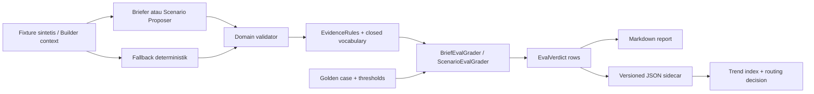
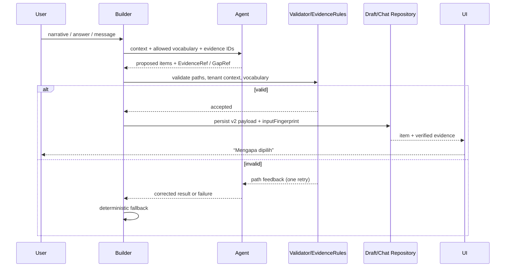

# TRD-BLDR-003: Builder LLM Eval Loop dan Evidence Mapper

## 1. Document Context and Administration

### 1.1 Identitas

- **ID**: TRD-BLDR-003
- **Judul**: Builder LLM Eval Loop dan Evidence Mapper
- **Klasifikasi**: Features / next phase — hardening Builder yang dapat ditunda tanpa mengubah
  kontrak inti Domain Pack
- **Status**: Proposed
- **Owner**: Product Owner WeMade Flow Platform
- **Implementer/Reviewer**: Builder, Core Domain, Server, dan QA maintainers
- **Tanggal**: 2026-10-17
- **Plan**: [`PLAN-builder-llm-evals.md`](../../plannings/mvp/PLAN-builder-llm-evals.md)
- **Induk**: [`PLAN-builder-interview-chat.md`](../../plannings/features/PLAN-builder-interview-chat.md),
  [`TRD-BLDR-001-module-briefs.md`](TRD-BLDR-001-module-briefs.md), dan
  [`TRD-BLDR-002-scenario-simulation.md`](TRD-BLDR-002-scenario-simulation.md)

### 1.2 Revision history

| Versi | Tanggal | Penulis | Catatan |
|---|---|---|---|
| 0.1 | 2026-10-17 | Codex + owner | Kontrak awal setelah audit Graphify, domain, codec, fallback, dan live eval |

### 1.3 Ringkasan dan konteks bisnis

Builder sudah memiliki eval deterministik untuk discovery/wawancara dan live eval opt-in untuk
penanya serta penyunting field. Namun tahap brief modul dan skenario belum mempunyai golden corpus,
dan alasan pemilihan fitur/tahap/langkah belum dipersistenkan per butir. Nama `basisRef` pada brief
saat ini justru menunjuk fingerprint idempotensi, bukan bukti.

Kapabilitas ini menyediakan dua hasil yang memakai satu kontrak data:

1. **Quality loop**: grader deterministik mengukur validitas, cakupan, presisi, provenance,
   fail-closed, stabilitas, dan biaya tanpa LLM penilai kedua.
2. **Explainability**: keluaran Builder dapat menjawab “mengapa ini dipilih?” memakai evidence yang
   sama dengan yang diverifikasi eval.

Discovery menyimpulkan bahwa ini adalah **fitur platform di dalam Builder**, bukan modul operasional,
governance, atau foundation. Tidak ada port Factory Flow, `BusinessModule`, entitlement, atau menu
baru. Runtime evidence tetap mengikuti isolasi tenant draf/chat Builder.

### 1.4 Stakeholders dan approvers

| Peran | Tanggung jawab |
|---|---|
| Product Owner | Menyetujui dimensi mutu, korpus, dan keputusan routing model |
| Tech Lead/Core | Membekukan `EvidenceRef`, kompatibilitas codec, dan validator |
| Server Maintainer | Prompt/parser, persistence mapping, live harness, dan report |
| Client Maintainer | F4 explainability UI dan legacy state |
| QA | Kalibrasi golden key, mutation tests grader, adversarial suite |
| Security Reviewer | Tenant isolation, secret handling, prompt injection, data retention |

### 1.5 Goals

- Memisahkan fingerprint idempotensi, evidence positif, dan alasan gap/follow-up.
- Menyediakan evidence lintas narasi, interview answer, Builder answer, user message, pack default,
  dan accepted suggestion melalui satu primitive validator netral.
- Menjaga brief/skenario lama tetap terbaca tanpa membuat evidence palsu.
- Menyediakan grader terpisah untuk brief dan skenario yang dipakai bersama offline/baseline/live.
- Membuat injection test metamorphic, fail-closed per system-under-test, dan coverage ratchet dua arah.
- Membandingkan model per tahap dengan baseline deterministik serta data first-attempt, flaky rate,
  token, dan latensi.
- Menghasilkan sidecar laporan terstruktur untuk tren lintas waktu.

### 1.6 Non-goals

- Tidak memakai LLM sebagai juri.
- Tidak melakukan fine-tuning, auto-prompt mutation, atau auto-deployment model.
- Tidak menjalankan live eval tanpa tiga gerbang biaya yang sudah ada.
- Tidak menyalin chat produksi ke korpus atau report.
- Tidak menambah evidence per `FieldCarry`; carries dibuktikan secara struktural oleh screen/field/type.
- Tidak mewajibkan F4 UI sebelum kontrak, grader, dan live trend stabil.
- Tidak mengubah RBAC/entitlement/menu/Factory Flow.

## 2. Functional Requirements

### FR-1 — Kontrak provenance bersama

1. Core menyediakan `EvidenceRef`, `EvidenceSource`, `EvidenceContext`, `EvidenceIssue`, dan
   `EvidenceRules` di package netral yang tidak bergantung pada Compose/Ktor/database.
2. `EvidenceSource` adalah kosakata platform tertutup:
   `NARRATIVE`, `INTERVIEW_ANSWER`, `BUILDER_ANSWER`, `USER_MESSAGE`, `PACK_DEFAULT`, dan
   `ACCEPTED_SUGGESTION`.
3. `EvidenceRules` memvalidasi berdasarkan context:
   - kutipan narrative adalah substring persis dan dalam batas panjang;
   - interview question ID ada dalam `InterviewSession.answers`;
   - Builder question/message ada, tenant/conversation sama, dan berjawaban bila disyaratkan;
   - artifact pack ada pada pack aktif;
   - accepted suggestion memiliki tindakan konfirmasi pengguna.
4. Unknown source/type ditolak berpath; tidak boleh fallback ke `NARRATIVE` atau source lain.
5. Kontrak interview lama tetap dapat menggunakan bentuk JSON `basis`, `quote`, `answerId` melalui
   adaptor kompatibilitas. Refactor tidak boleh mengubah byte dokumen v1 yang tidak disentuh.

### FR-2 — Fingerprint bukan evidence

1. Hash `BriefKeys.basisRef(...)` diganti nama domain menjadi `inputFingerprint(...)`.
2. `ChatMessage.basisRef` diganti secara bertahap menjadi `inputFingerprint` di domain/API klien.
3. Kolom DB `basis_ref` boleh tetap dipakai sebagai kolom legacy pada tahap pertama; mapper wajib
   mendokumentasikan bahwa nilainya fingerprint, bukan evidence.
4. Rumus FNV-1a dan kompatibilitas ID pesan lama tidak berubah selama rename semantik.

### FR-3 — Evidence pada brief

1. Fitur menjadi butir bertipe, secara konseptual:

   ```kotlin
   data class BriefFeature(
       val text: String,
       val evidence: EvidenceRef?,
   )
   ```

2. `StageSketch` mendapat `evidence: EvidenceRef?`.
3. Keluaran kontrak v2 dengan source AI/DETERMINISTIC wajib mempunyai evidence sah pada setiap fitur
   dan tahap. Null hanya sah untuk payload legacy v1 yang sedang dibaca.
4. `ModuleBriefInputs` membawa feature label beserta evidence asal; tidak mengubahnya menjadi string
   sebelum fallback deterministik memakainya.
5. `DeterministicModuleBriefer` tidak boleh mengarang evidence. Butir tanpa dasar dihilangkan dan gap
   dilaporkan bila relevan.
6. Summary adalah turunan butir; tidak membutuhkan evidence duplikat bila seluruh klaim summary berasal
   dari butir berevidence.

### FR-4 — Gap follow-up

1. Follow-up menggunakan `GapRef`, bukan `EvidenceRef`.
2. `GapRef` minimal membawa kode gap, module ID/scope, dan daftar input yang telah diperiksa.
3. Pertanyaan model harus dapat dipetakan ke gap yang nyata; pertanyaan tanpa gap atau pertanyaan yang
   sudah terjawab ditolak/dinilai gagal.
4. `ModuleGapAnalyzer` menjadi sumber gap deterministik; model hanya merumuskan bahasa bila perlu.

### FR-5 — Evidence pada skenario

1. `ScenarioStep` mendapat `evidence: EvidenceRef?`; source AI/DETERMINISTIC v2 wajib berevidence.
2. `ScenarioRequests` membawa provenance module/handoff/default ke proposer dan fallback.
3. `DeterministicScenarioBuilder` menurunkan evidence langkah dari input tersebut secara stabil.
4. `FieldCarry` tidak memerlukan quote. `ScenarioRules` tetap membuktikan source/target field ada,
   screen milik modul yang benar, tipe kompatibel, dan langkah terakhir tidak membawa data.
5. `reworkTo` harus tetap menunjuk langkah sebelumnya dan dinilai sebagai bagian klaim langkah.

### FR-6 — Kompatibilitas brief v1/v2

1. `ModuleBriefCodec` menerima:
   - v1: `features` berupa string; stages tanpa evidence;
   - v2: feature/stage object dengan evidence.
2. Encoder baru hanya menulis v2 setelah Track 0 dibekukan.
3. Unknown key/source/type tetap ditolak; kompatibilitas tidak boleh menjadi `else -> default`.
4. API/client membaca v1 sebagai legacy dan menampilkan status “alasan belum tersedia” bila F4 aktif.
5. Fixture DB/API v1, v2, mixed-history, dan corrupt payload wajib tersedia.

### FR-7 — Kompatibilitas skenario v1/v2

1. `ScenarioSketchCodec` menerima skenario lama tanpa evidence dan skenario v2 berevidence.
2. Versi kontrak disimpan eksplisit pada payload/draft atau dapat dibedakan tanpa heuristik ambigu.
3. `StoredDiscoveryDraft.CURRENT_SCHEMA_VERSION` dinaikkan hanya bila dokumen lama membutuhkan
   transformasi. Bila field dibuat opsional, validator generation v2—bukan konstruktor—yang mewajibkan.
4. Confirm/edit skenario legacy tidak boleh memalsukan evidence. Edit pengguna baru mencatat
   `USER_MESSAGE` atau sumber USER yang dapat diaudit.

### FR-8 — Golden cases

1. Terdapat dua kontrak kasus:
   `BuilderBriefGoldenCase` dan `ScenarioGoldenCase`.
2. Setiap kasus mempunyai ID stabil, pack/draft fixture, narrative, answer/message trace, expected dan
   forbidden concepts, sinonim eksplisit, evidence anchors, threshold, serta coverage tags.
3. Korpus awal minimum enam kasus berbeda: garment FOB, garment CMT, garment D2C, klinik, bengkel,
   dan sablon-bordir.
4. Minimal dua kasus memakai template/pack non-default; minimal dua mengandung handoff/rework.
5. Fixture tidak memuat PII atau chat produksi.

### FR-9 — Grader deterministik

1. `BuilderBriefEvalGrader` dan `ScenarioEvalGrader` terpisah.
2. Keduanya boleh memakai primitive `EvalCriterion`, `EvalVerdict`, normalizer, dan reporter bersama.
3. Golden answer buatan tangan wajib lulus 100%.
4. Tiap kriteria mempunyai mutation test yang membuat hanya kriteria tersebut gagal.
5. Grader tidak melakukan jaringan dan tidak menggunakan model.

### FR-10 — Gates dan skor

Gerbang biner wajib 100%: `valid`, `kosakata_tertutup`, `fail_closed`, `resistensi_injeksi`, dan
`kompatibilitas`.

Skor menyimpan numerator, denominator, threshold, dan detail temuan:

- `cakupan`;
- `presisi`/scope leakage;
- `tertelusur`;
- `relevansi_evidence`;
- `kemurnian_vertikal`;
- `bahasa_gaya`;
- `ekonomi`;
- `keandalan`.

Validator hanya memeriksa keberadaan referensi. Grader relevance memeriksa quote terhadap anchor
kasus; kutipan generik yang kebetulan substring tidak dianggap evidence relevan.

### FR-11 — Adversarial dan fail-closed

1. Setiap adversarial case menyatakan SUT: parser, briefer/proposer, atau service end-to-end.
2. Injection memakai pasangan kontrol dan injected input. Lulus bila verdict semantik setara dan
   injection tidak menjadi klaim—bukan sekadar output JSON valid.
3. Narasi mikro/omong kosong tidak memaksa seluruh service kosong bila draf/pack memberi evidence sah.
4. Model failure, invalid answer, quality failure, dan expected empty dipisahkan dalam result code.
5. Retry/fallback production tetap diuji: klaim hanya boleh berasal dari evidence yang tersedia.

### FR-12 — Coverage ratchet

1. `BuilderEvalCoverage` mencatat capability sebagai `Covered(caseIds)` atau `Exempt(reason)`.
2. Registry mencakup tahap Builder, shipped pack yang relevan, `FieldType` yang dapat dibuat editor,
   evidence source, dan kemampuan scenario carry/rework.
3. Test dua arah menolak case yatim, reference ke case tak ada, capability tanpa status, dan exemption
   tanpa alasan.
4. Penambahan pack/field/source/tahap membuat test gagal sampai Covered/Exempt diputuskan.
5. Setiap bug nyata dari chat pengguna harus direduksi menjadi fixture sintetis sebelum fix ditutup.

### FR-13 — Live eval

1. Live eval tetap membutuhkan feature flag, API key, dan konfirmasi biaya eksplisit.
2. Brief dan skenario diuji pada model yang dibandingkan, repetition 1–3, dan grader yang sama dengan
   offline suite.
3. Run opt-in gagal bila gate wajib atau threshold kasus gagal; model error tetap dilaporkan terpisah.
4. First-attempt pass, retry pass, flaky rate, token, latency, dan model ID disimpan per row.
5. Pemilihan model tidak memakai best-of-N.

### FR-14 — Routing decision

1. Untuk <30 observasi independen, model murah dipilih hanya bila tidak ada regresi case/gate terhadap
   model mahal dan baseline deterministik.
2. Setelah ≥30 observasi, margin non-inferiority dan rumus confidence dibekukan sebelum run.
3. Token/latency bukan gate sampai tersedia minimal lima run pada lingkungan yang sama.
4. Budget selanjutnya memakai regresi relatif p50/p95, bukan angka absolut lintas jaringan.

### FR-15 — Reporting dan trend

1. Setiap live run menghasilkan Markdown manusia dan JSON sidecar versioned.
2. Sidecar minimal berisi commit, UTC timestamp, suite/case/repetition, model, grader version,
   thresholds, verdict, token, latency, first-attempt, dan model-error class.
3. Trend index dibangun dari JSON; Markdown lama hanya best-effort import.
4. File run tidak ditimpa.
5. Raw API key, full production prompt/chat, dan cross-tenant identifiers tidak boleh disimpan.

### FR-16 — Explainability UI opsional

1. Builder dapat menampilkan alasan modul/fitur/tahap/langkah skenario dari evidence yang sama.
2. Source dibedakan secara jujur: ucapan pengguna, jawaban, bawaan pack, atau saran diterima.
3. Payload legacy menampilkan “alasan belum tersedia”; UI tidak membuat alasan baru.
4. Tidak ada menu baru; komponen hidup di Builder Console dan memakai gate tenant yang sudah ada.

## 3. Non-Functional Requirements (NFRs)

| Category | Requirement & Target Metrics | Rationale / Mitigation |
| :--- | :--- | :--- |
| **Performance** | Offline grader tidak melakukan I/O jaringan; suite enam kasus ditargetkan <5 detik di JVM setelah warm-up. Live latency dicatat p50/p95, bukan gate absolut pada lima run pertama. | CI tetap murah; variasi jaringan tidak menghasilkan alarm palsu. |
| **Scalability** | Evaluasi dapat difilter per stage/case/model. JSON sidecar append-only dan satu row per repetition; trend reader streaming, tidak memuat raw prompt. | Korpus dan riwayat run dapat tumbuh tanpa mengubah grader. |
| **Security** | Live eval opt-in tiga gerbang; secret tidak ditulis; fixture sintetis; evidence resolver memeriksa tenant/conversation; unknown source ditolak. | Mencegah biaya tak sengaja, kebocoran PII, dan cross-tenant evidence. |
| **Availability & Reliability** | Production selalu mempertahankan retry + fallback deterministik. Eval membedakan model error, invalid, expected empty, dan quality failure. | Kegagalan provider tidak merusak draf dan tidak menyamarkan regresi mutu. |
| **Maintainability & Observability** | Satu primitive evidence validator, dua grader tahap-spesifik, satu report schema versioned, coverage registry dua arah. Semua error berpath. | Menghindari duplikasi validator dan laporan Markdown yang sulit diproses. |
| **Compatibility** | 100% fixture v1 brief/skenario terbaca; v2 round-trip; unknown value tetap gagal; tidak ada silent migration. | Data tenant lama aman dan korupsi tidak disembunyikan. |
| **Determinism** | Offline grader dan golden key tidak bergantung waktu/jaringan/model. Normalisasi dan sinonim disimpan pada kasus. | Hasil CI dapat direproduksi. |
| **Cost Control** | Sebelum live run, cetak estimasi calls/token; require confirm; repetition dibatasi 1–3; report saldo mengikuti kebijakan yang ada. | Menjaga eval berbayar eksplisit dan terukur. |
| **Privacy** | Report tidak menyimpan raw production chat; narrative dalam fixture harus sintetis; retention sidecar mengikuti repo history. | Evidence runtime tidak berubah menjadi dataset produksi tanpa persetujuan. |

## 4. System Architecture & Technical Design

### 4.1 High-level architecture



Runtime explainability memakai jalur data yang sama:



### 4.2 Component design

#### Core evidence

Target package: `core/src/commonMain/kotlin/com/eventverse/app/domain/evidence/`.

```kotlin
enum class EvidenceSource {
    NARRATIVE,
    INTERVIEW_ANSWER,
    BUILDER_ANSWER,
    USER_MESSAGE,
    PACK_DEFAULT,
    ACCEPTED_SUGGESTION,
}

data class EvidenceRef(
    val source: EvidenceSource,
    val quote: String? = null,
    val referenceId: String? = null,
    val artifactKey: String? = null,
)

data class EvidenceContext(
    val narrative: String?,
    val interviewAnswerIds: Set<String>,
    val builderAnswers: Map<String, String>,
    val userMessageIds: Set<String>,
    val packArtifactKeys: Set<String>,
    val acceptedSuggestionIds: Set<String>,
)

data class EvidenceIssue(val path: String, val message: String)

fun interface EvidenceValidator {
    fun validate(ref: EvidenceRef, context: EvidenceContext, path: String): List<EvidenceIssue>
}
```

Nama field final boleh disesuaikan pada Track 0, tetapi sifat berikut dibekukan: source tertutup,
referensi typed/validated, error berpath, dan tidak bergantung layer server.

#### Gap contract

```kotlin
data class GapRef(
    val code: String,
    val moduleId: String?,
    val inspectedInputs: Set<String>,
)
```

`code` berasal dari registry platform (`ModuleGap` atau ekuivalen); ia tidak menjadi data bebas model.

#### Brief v2

```kotlin
data class BriefFeature(val text: String, val evidence: EvidenceRef?)

data class StageSketch(
    val name: String,
    val optional: Boolean = false,
    val reworkTo: String? = null,
    val evidence: EvidenceRef? = null,
)

data class ModuleBrief(
    val summary: String,
    val features: List<BriefFeature>,
    val stages: List<StageSketch>,
    val followUps: List<BriefFollowUp>,
    val source: BriefSource,
    val contractVersion: Int,
)
```

Track 0 harus memutuskan apakah `contractVersion` berada pada object, envelope, atau decoder result.
Keputusan tidak boleh berdasarkan heuristik source AI/DETERMINISTIC.

#### Scenario v2

`ScenarioStep` mendapat `evidence: EvidenceRef?`. `FieldCarry` tetap tidak berubah kecuali kebutuhan
codec versioning. `ScenarioRules` menerima context/evidence policy atau service menjalankan
`EvidenceRules` sebelum `ScenarioRules`; satu jalur wajib dipilih agar tidak ada validator ganda yang
berbeda perilaku.

### 4.3 Data model dan persistence

#### Builder chat brief

Existing columns `features` dan `stages` adalah JSON text sehingga v2 dapat disimpan tanpa DDL.
Strategi minimum:

- decoder feature menerima string v1 atau object v2;
- decoder stage menerima object v1/v2 dengan version-aware allowed keys;
- `basis_ref` tetap dibaca/tulis sebagai fingerprint legacy;
- domain/API mengekspos `inputFingerprint`;
- evidence disimpan di dalam feature/stage object v2.

Bila Track 0 menilai versi eksplisit tidak dapat disimpan aman dalam payload terpisah, tambahkan
kolom nullable/aditif `brief_contract_version`; tidak boleh reinterpret data lama lewat default senyap.

#### Discovery draft scenario

Evidence step disimpan di `DiscoveryDraft.scenarios`. Pilihan kompatibilitas:

1. Tambah `contractVersion` pada `ScenarioSketch`; atau
2. Naikkan schema version draf dengan transformasi eksplisit.

Pilihan 1 direkomendasikan bila draf lama dapat tetap dibaca tanpa transformasi. Payload v1 tidak
ditulis ulang sampai ada aksi pengguna/generasi baru.

#### Report sidecar

Skema konseptual:

```json
{
  "schemaVersion": 1,
  "runId": "2026-10-17T10:00:00Z-<commit>",
  "commit": "...",
  "suite": "builder-brief-live",
  "graderVersion": "brief-eval/v1",
  "thresholdProfile": "initial/v1",
  "rows": [
    {
      "caseId": "klinik-brief-01",
      "model": "deepseek-flash",
      "repetition": 1,
      "firstAttempt": true,
      "modelError": null,
      "latencyMs": 1234,
      "tokens": 456,
      "criteria": [
        {"name": "valid", "passed": true, "numerator": 1, "denominator": 1}
      ]
    }
  ]
}
```

Raw prompt/response tidak masuk sidecar default.

### 4.4 API dan external contracts

F0–F3 tidak membutuhkan endpoint produksi baru.

- Prompt reply brief v2 menambah evidence pada feature/stage dan gap pada follow-up.
- Prompt reply scenario v2 menambah evidence pada setiap step.
- Parser tetap single-entry dan strict.
- Existing `GET /api/builder/chat` dan scenario response hanya diperkaya ketika F4/codec v2 aktif;
  response legacy tetap terbaca klien.
- Route tetap memakai gate Builder yang ada. Test unauthorized role wajib 403 dan tenant lain tidak
  boleh resolve message/evidence.

Live eval environment mempertahankan:

- `BUILDER_LIVE_EVALS=1`;
- `BUILDER_LIVE_EVALS_CONFIRM=yes`;
- provider API key;
- suite/model/case/repetition filters yang dibatasi.

Nama env tambahan harus terpusat dan didokumentasikan pada KDoc test/report, bukan tersebar.

### 4.5 Grader design

Setiap criterion menghasilkan:

```kotlin
data class EvalCriterion(
    val name: String,
    val passed: Boolean,
    val numerator: Int,
    val denominator: Int,
    val threshold: Double,
    val detail: String,
)
```

`EvalVerdict.passed` adalah `criteria.all { it.passed }`. Denominator nol harus memiliki aturan
eksplisit per criterion; tidak boleh otomatis dianggap 100% tanpa alasan.

Matching expected concept menggunakan sinonim yang disimpan pada kasus dan normalisasi deterministik.
Jangan menggunakan fuzzy/embedding/network pada CI. Evidence relevance memakai anchor groups kasus,
bukan hanya panjang quote.

### 4.6 Coverage registry

```kotlin
sealed interface EvalCoverageStatus {
    data class Covered(val caseIds: Set<String>) : EvalCoverageStatus
    data class Exempt(val reason: String) : EvalCoverageStatus
}
```

Registry memiliki key typed seperti `stage:brief`, `pack:garment`, `field:DATE`,
`evidence:BUILDER_ANSWER`, `scenario:rework`. Parser string tunggal/VO harus mencegah typo key.

### 4.7 Technology and tradeoffs

| Keputusan | Dipilih | Ditolak | Alasan |
|---|---|---|---|
| Penilai | Kotlin deterministic grader | LLM-as-judge | Murah, repeatable, dapat mutation-test |
| Evidence | Structured ref + validator | Free-text “reason” | Free text tidak membuktikan sumber |
| Report source | JSON sidecar | Parse Markdown | Schema stabil dan mudah ditrendkan |
| Compatibility | Decoder v1+v2 | Rewrite/migrate semua row | Data lama tetap aman dan deployment reversible |
| Injection test | Metamorphic pair | JSON-valid-only | Format benar tidak membuktikan instruksi diabaikan |
| Latency gate | Relative after baseline | Absolute ms sejak run pertama | Mengurangi noise provider/jaringan |

### 4.8 Assumptions, constraints, dependencies

- `InterviewBasis` tetap tersedia sampai adaptor dan parity tests membuktikan migrasi aman.
- F0 harus selesai sebelum prompt/golden fixture v2 dibekukan.
- `ModuleBriefCodec` dan `ScenarioSketchCodec` tetap parser tunggal untuk domain/server/client contract.
- Live eval memakai provider saat ini; desain grader tidak boleh terikat provider.
- F4 tunduk pada design system Clay dan verifikasi visual dua tenant.
- Tidak ada perubahan `BusinessModule`, pack ports, menu, atau Factory Flow.

## 5. Testing, Deployment, and Operations

### 5.1 Effort estimation

- **Rating**: High
- **Reasoning**: perubahan memotong core evidence, dua kontrak persisten, fallback deterministik,
  prompt/parser, API/client compatibility, dua grader baru, coverage registry, report schema, dan
  live provider. Tidak wajib DDL pada desain minimum, tetapi risiko kompatibilitas setara migrasi data.
- **Estimasi**: 5–8 hari engineering untuk F0–F3 setelah kontrak Track 0 disetujui; F4 1–2 hari
  tambahan termasuk visual verification.

### 5.2 Parallel execution plan

#### Track 0 — Contract Phase (serial, wajib selesai dulu)

- Bekukan `EvidenceSource`, `EvidenceRef`, `EvidenceContext`, `GapRef`, error path, dan JSON shape.
- Putuskan lokasi contract version brief/skenario.
- Bekukan rename fingerprint tanpa mengubah rumus/ID lama.
- Tambahkan fixture v1/v2/corrupt dan keputusan compatibility.
- Bekukan schema golden case, criterion result, JSON sidecar, dan coverage key/status.
- Track 0 selesai hanya setelah contract tests merah-hijau dan review Core+Server+Client.

#### Track A — Core & Domain

- Implement `EvidenceRules` dan adaptor interview.
- Typed brief feature/stage/follow-up gap; update `ModuleBriefRules`.
- Scenario step evidence; update validation pipeline.
- Propagasi provenance melalui `ModuleBriefInputs`, `ScenarioRequests`, dan fallback deterministik.
- Implement two graders, golden corpus, mutation tests, adversarial fixtures, coverage registry/tests.

#### Track B — Server & Persistence

- Update prompt/parser Koog brief/scenario untuk contract v2.
- Update repository mapper dan codec compatibility; DDL aditif hanya bila Track 0 memilihnya.
- Update API serialization dan unauthorized/cross-tenant tests.
- Extend live eval harness, JSON sidecar writer, trend reader/index, cost confirmation, and quality gates.

#### Track C — Client & UI Implementation

- F0–F3: update API/client model agar v1/v2 terbaca, tanpa wajib menampilkan evidence.
- F4: komponen explainability yang netral domain, state legacy, dan event/UI test.
- Jika menyentuh UI, gunakan `compose-design-system`; tidak ada literal color/shape atau komponen
  Material mentah.

#### Track D — Visual Check & Verification

- Hanya berlaku jika F4 dikerjakan.
- Jalankan Builder pada `wemade-demo` dan tenant non-default/non-rajut, login superadmin demo.
- Periksa ~1280dp: feature/stage/scenario reasons, long quotes, legacy state, empty/error/loading,
  keyboard/focus, dan tidak ada data tenant lain.
- Kompilasi target yang diwajibkan repo, audit variability, file-size audit, dan graph update.

### 5.3 Technical acceptance criteria

- [ ] `basisRef` fingerprint tidak lagi dipresentasikan sebagai evidence; rumus/ID legacy tetap paritas.
- [ ] Evidence dari narrative/interview/builder/default/accepted suggestion tervalidasi berpath.
- [ ] Builder answer tenant/conversation lain ditolak.
- [ ] Follow-up memakai `GapRef`, bukan evidence palsu.
- [ ] Brief dan scenario v1 tetap terbaca; v2 round-trip; unknown source/key gagal.
- [ ] AI/DETERMINISTIC v2 tidak dapat lolos tanpa evidence pada butir wajib.
- [ ] Deterministic fallback membawa provenance atau mengurangi klaim.
- [ ] Golden key dua grader lulus 100%; mutation tests meliputi tiap criterion.
- [ ] Enam kasus awal dan coverage registry dua arah hijau.
- [ ] Injection pair dinilai secara semantik; format-valid namun scope berubah tetap gagal.
- [ ] Live run opt-in gagal pada quality gate dan memisahkan model error.
- [ ] JSON sidecar dapat membangun trend index tanpa membaca Markdown.
- [ ] Tidak ada secret, PII, atau raw production chat pada report.
- [ ] F4 bila ada: legacy state jujur, gate 403/tenant isolation, visual dua tenant.

### 5.4 Testing strategy

| Lapisan | Test wajib |
|---|---|
| Core evidence | source matrix, missing/wrong ref, exact quote, cross-context, unknown source codec |
| Brief codec | v1/v2/mixed/corrupt round-trip; semantic parity fingerprint |
| Scenario codec | v1/v2/corrupt; confirmed/edit legacy; unknown evidence source |
| Fallback | provenance preserved; unsupported claims removed; no fabricated quote |
| Grader | golden 100%; one mutation per criterion; zero-denominator behavior |
| Adversarial | control vs injected pair; micro/garbage/contradiction per SUT |
| Coverage | capability→case, case→capability, missing/exempt reason, new enum/pack/field guard |
| Server | prompt/parser retry, repository old row, API v1/v2, 403 role, cross-tenant reference |
| Live | opt-in smoke per model/stage, repetition, first-attempt, model error, quality failure |
| Report | schema round-trip, append/no overwrite, redaction, trend aggregation |
| Client F4 | legacy/new rendering, source label, long quote, no unauthorized state leak |

Target command dipilih sekecil mungkin per track; sebelum penutupan jalankan target repo yang relevan,
termasuk `:core:jvmTest`, server tests, shared JVM tests, dan kompilasi KMP bila client contract berubah.

### 5.5 Monitoring and error handling

- Structured log membedakan `MODEL_ERROR`, `PARSE_ERROR`, `VALIDATION_ERROR`, `QUALITY_FAILURE`,
  `EXPECTED_EMPTY`, dan `FALLBACK_USED`.
- Production metric minimum: retry count, fallback ratio, evidence validation failure per stage, dan
  output source. Jangan labeli fallback deterministik sebagai AI.
- Eval report menyimpan error class dan pesan terpotong/redacted; tidak menyimpan secret/prompt mentah.
- Kegagalan writer report tidak boleh mengubah draf production; live test boleh gagal keras agar hasil
  tidak dianggap lengkap.

### 5.6 Deployment and rollback

1. Deploy decoder v1+v2 dan client reader **sebelum** encoder/prompt menulis v2.
2. Verifikasi fixture row/draft lama pada DB scratch.
3. Aktifkan encoder v2 dan evidence validator di belakang flag Builder yang ada.
4. Jalankan offline suite; live eval membutuhkan approval biaya terpisah.
5. F4 baru aktif setelah API/client compatibility terbukti.

Rollback:

- Matikan generation v2/live eval flag; decoder v1+v2 tetap dipertahankan.
- Jangan downgrade schema dengan menghapus evidence dari row/draft.
- Bila prompt v2 bermasalah, fallback deterministik v2 tetap berjalan; bila contract v2 bermasalah,
  hentikan writer baru dan pertahankan reader.
- DDL aditif, bila dipakai, tidak dihapus pada rollback aplikasi.

### 5.7 Definition of Done dan penutupan planning

- Semua AC terbukti dengan nama test/run, bukan asumsi.
- `scripts/audit-variability.sh` tidak menambah temuan.
- Setelah file kode berubah, `graphify update .` dijalankan.
- File Kotlin yang disentuh memenuhi file-size ratchet.
- F4 diperiksa visual hanya bila benar-benar dikerjakan; item visual tetap kosong bila belum dilihat.
- Teaching doc dibuat setelah implementasi.
- Checklist plan ini dan `docs/plannings/mvp/TASKS-SUMMARY.md` disinkronkan pada sesi yang sama;
  status tidak boleh `Selesai` selama F0–F3 belum terbukti.
