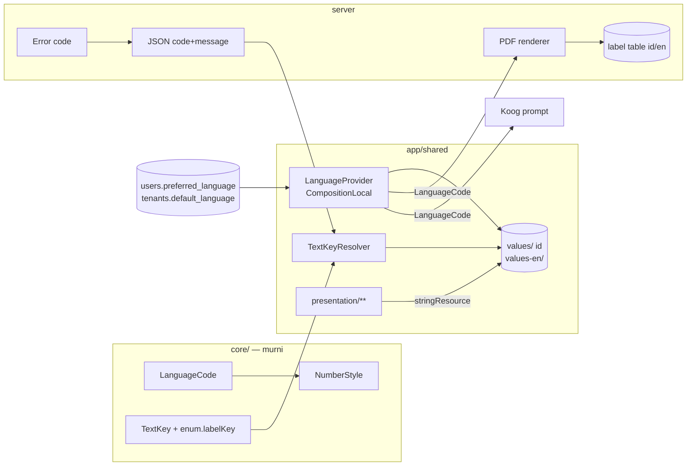

# TRD-I18N-001: Multibahasa (Indonesia + Inggris) — UI, Label Sistem, Server & Agent

## 1. Document Context and Administration

- **Title & ID**: TRD-I18N-001 — Fase 1 multibahasa: infrastruktur bahasa, UI, label sistem `core/`, server/PDF, agent AI
- **Status**: Draf 1 untuk persetujuan · **Tanggal**: 2026-10-13 · **Pemilik**: Achmad Jamaludin
- **Pasangan**: [`TRD-I18N-002`](TRD-I18N-002-lokalisasi-data-pack.md) (Fase 2, data pack) · **Plan**: [`PLAN-i18n-phase1-ui-system.md`](../../plannings/features/PLAN-i18n-phase1-ui-system.md)
- **Prioritas**: `features/` (bisa ditunda; bukan kontrak inti MVP)

### Revision History

| Versi | Tanggal | Penulis | Catatan |
|---|---|---|---|
| 0.1 | 2026-10-13 | Claude (atas permintaan Achmad) | Draf dari scan kode 2026-10-13 |

### Summary & Business Context

Seluruh teks aplikasi berbahasa Indonesia dan tertanam di kode. Hasil scan (hitungan regex, perkiraan):

| Temuan | Angka |
|---|---|
| File Kotlin `presentation/` | 421 |
| Literal kalimat di `presentation/` | ±2.200 (`Text("...")` literal di 83 file) |
| Pemakaian `stringResource` | 0; tidak ada `values-*` di `composeResources` |
| Label non-pack di `core/` (properti `label/title/displayName/name`) | ±400 |
| Pesan error server berupa literal | ±3 (kecil) |
| Rujukan locale | 8 file; format angka/tanggal **sengaja bebas locale** (`IdrFormat`, `NumberFormatting`, `BriefRenderer`) |
| Teks Indonesia vs Inggris di literal | ±430 vs ±2 |

Tujuan: aplikasi bisa dipakai penuh dalam **Indonesia (id)** dan **Inggris (en)**, dipilih per pengguna dengan
bawaan per tenant. Bahasa dasar = Indonesia (tak ada regresi untuk pengguna sekarang). Teks **data pack**
(nama modul, tahap, slot, tutorial) ada di Fase 2 (TRD-I18N-002) — dokumen ini hanya menyiapkan
`LanguageCode` dan mekanisme pilih bahasa yang dipakainya.

### Stakeholders & Approvers
Product (Achmad), Tech Lead, QA, Developer.

### Goals (In-Scope)

- Value object `LanguageCode` (`id`, `en`) + `AppLanguage` yang dipilih di runtime di 5 target.
- Resource string Compose Multiplatform (`values/` = id, `values-en/`) + pemindahan ±2.200 literal UI.
- Label sistem `core/` (status teknis, enum sistem, peran platform) dirender lewat **kunci** (`TextKey`), bukan string
  tertanam; core tidak bergantung pada Compose resources.
- Format angka, mata uang (tetap IDR), dan tanggal sadar bahasa (parameter, bukan `Locale` platform).
- Server: pesan error berbasis **kode** + klien memetakan ke teks; PDF/cetak menerima parameter bahasa.
- Agent AI (Koog): bahasa keluaran mengikuti bahasa pengguna.
- Pilihan bahasa pengguna tersimpan (profil) + bawaan tenant.
- Gerbang otomatis: tes paritas kunci, skrip audit literal (ratchet).

### Non-Goals (Out-of-Scope)

- Terjemahan data pack (garment) dan template tahap → TRD-I18N-002.
- Teks yang ditulis tenant (nama tahap kustom, modul kustom, isi dokumen) — tetap satu bahasa buatan tenant.
- Bahasa ketiga, RTL, pluralisasi lanjutan (ICU) — hanya disiapkan, tidak dibangun.
- Mengubah mata uang menurut bahasa (tetap IDR).
- Terjemahan konten tutorial/wawancara panjang (Fase 2).

## 2. Functional Requirements

### F1 — Memilih bahasa
- Pengguna memilih id/en di pengaturan profil dan di layar login (sebelum autentikasi, disimpan lokal).
- Urutan penentuan: pilihan pengguna → bawaan tenant → `id`. Nilai tak dikenal **ditolak** (Kontrak 4), bukan jatuh ke `id`.
- Perubahan berlaku langsung tanpa muat ulang (state di `CompositionLocal`/ViewModel).

### F2 — String UI
- Semua teks tampilan `presentation/**` memakai `stringResource(Res.string.<kunci>)`; kunci dinamai per **peran**
  (`common_save`, `fulfillment_carton_seal_action`), bukan per teks.
- Placeholder bernama; tes memastikan jumlah/nama placeholder id = en.
- Dilarang literal kalimat baru di `Text(...)`; audit melaporkan, ratchet mencegah bertambah.

### F3 — Label sistem di `core/`
- Enum sistem (`CartonStatus`, `ShipmentStatus`, `FlowHealthStatus`, `StageKind`, …) mengekspos `labelKey: TextKey`
  (value class string), bukan `label: String`.
- Peta `TextKey → Res.string` hidup di `app/shared`; tes iterasi `enum.entries` memastikan tiap entri punya padanan
  di kedua bahasa (entri baru tanpa padanan → tes gagal, pola Strangler Fig Kontrak 8).
- Warna/`colorHex` tetap data domain, tidak tersentuh.

### F4 — Format
- `IdrFormat` dan format desimal menerima `NumberStyle(groupSeparator, decimalSeparator)` turunan `LanguageCode`
  (id: `1.234,50`; en: `1,234.50`). Tanpa `java.util.Locale` di commonMain.
- Tanggal: pola per bahasa lewat `kotlinx.datetime`, tanpa API locale platform.

### F5 — Server
- Respons error membawa `code` stabil (mis. `carton_sealed_immutable`) + `message` Indonesia sebagai catatan log;
  klien menampilkan teks dari resource berdasarkan `code`. Kode tak dikenal klien → tampil pesan umum **dengan kode
  terlihat** (bukan menelan).
- PDF/cetak (`SpkCardPdfRenderer`, `PrintLabels`, SJ): menerima `LanguageCode`; label cetak dari tabel kunci server.
- Endpoint tulis tetap fail-closed; menambah `preferred_language` tidak mengubah RBAC.

### F6 — Agent AI
- Prompt Koog menerima `LanguageCode` keluaran; `screen_catalog` tetap kosakata sistem (kode), teks tampilan mengikuti bahasa.
- Evaluasi deterministik (tanpa LLM berbayar) memeriksa prompt id dan en terbentuk dan tidak saling bocor.

## 3. Non-Functional Requirements (NFRs)

| Category | Requirement & Target Metrics | Rationale / Mitigation |
| :--- | :--- | :--- |
| **Performance** | Ganti bahasa < 1 frame budget tambahan; muat resource tidak menambah waktu start > 50 ms (Wasm/JS) | Resource string kecil; hindari memuat bahasa tak dipakai |
| **Scalability** | ±2.600 kunci × 2 bahasa; ukuran bundle Wasm/JS naik < 150 KB | Pecah file `strings_<fitur>.xml` per fitur agar diff terbaca |
| **Security** | Pesan server tidak membocorkan detail internal; `preferred_language` divalidasi enum, bukan string bebas | Kontrak 4: tolak nilai tak dikenal |
| **Availability & Reliability** | Kunci hilang di salah satu bahasa **gagal di CI**, bukan runtime; runtime tidak diam-diam jatuh ke bahasa lain | Tes paritas + audit; kode error tak dikenal tetap menampilkan kode |
| **Maintainability & Observability** | Satu file = satu fitur; kunci per peran; ratchet audit literal; telemetri jumlah kunci yatim | File-size rules: string XML tidak kena batas Kotlin, tapi tetap dipecah per fitur |
| **UX/Layout** | Teks Inggris ±20–30% lebih panjang; layar padat Clay dicek di ~1280dp dan kolom swimlane 324dp | Design system Kontrak 12/13: `weight(1f, fill=false)` + `maxLines` + `overflow` |

## 4. System Architecture & Technical Design

### High-Level Architecture

### Detailed Component Design

- `core/.../domain/i18n/LanguageCode.kt` — `@JvmInline value class`, parser tunggal `LanguageCode.parse(String)`
  yang melempar untuk nilai tak dikenal; konstanta `ID`, `EN`; `supported` daftar tertutup.
- `core/.../domain/i18n/TextKey.kt` — value class string; `NumberStyle.of(LanguageCode)`.
- `app/shared/.../presentation/i18n/` — `LanguageProvider`, `LocalAppLanguage`, `TextKeyResolver`
  (`when(key)` tanpa `else`, atau tabel yang dijaga tes iterasi).
- Override locale runtime: Compose Resources memilih bahasa dari lingkungan sistem; override per target
  (Android/iOS/Desktop/JS/Wasm) **diverifikasi di Track 0 (spike)** — bila API resmi tidak cukup, bungkus
  `ResourceEnvironment`/`LocalComposeEnvironment`. Hasil spike mengunci desain.
- `IdrFormat`, `NumberFormatting`, `BriefRenderer` menerima `NumberStyle`.

### Data Model & Schema

Migrasi `V103` (nomor berikutnya diverifikasi saat Track B):
- `public.users.preferred_language TEXT NULL CHECK (preferred_language IN ('id','en'))`
- `public.tenants.default_language TEXT NOT NULL DEFAULT 'id' CHECK (... IN ('id','en'))`

Tanpa tabel modul baru; fitur ini bukan modul (mewarisi RBAC/entitlement; tidak masuk `ModuleSchemaMap`).
Tidak ada backfill selain default `id`.

### API Specifications & External Contracts

| Endpoint | Metode | Gerbang | Catatan |
|---|---|---|---|
| `/api/me/language` | PUT | login (data diri sendiri) | body `{language:"en"}`; kode tak dikenal → 400 |
| `/api/tenant/language` | PUT | MANAGE pada modul governance pengaturan tenant (fail-closed; **403** untuk peran lain) | bawaan tenant |
| Semua error ber-`code` | — | — | `{code, message}`; `message` Indonesia untuk log |

### Technology Usage & Tradeoff Justification

| Pilihan | Alasan | Alternatif ditolak |
|---|---|---|
| Compose Multiplatform Resources (`stringResource`) | Satu mekanisme di 5 target, terintegrasi Gradle | Peta string buatan sendiri: tak ada tooling; library pihak ketiga: dependensi baru di 5 target |
| `TextKey` di core, resolusi di app | Core tidak boleh impor Compose (DDD) | Resource di core: melanggar aturan layer |
| Server kirim **kode**, klien menerjemah | Satu sumber teks UI; hemat | Server menerjemah via `Accept-Language`: dua sumber terjemahan |
| Bahasa jadi parameter format | Konsisten di 5 target | `java.util.Locale`: tak ada di commonMain |

### Keputusan Alur Terjemahan (2026-10-13)
- **Terjemahan lewat kode dulu**: kunci id dan en ditulis bersama di `values/` dan `values-en/`, oleh developer/agent, dengan tinjauan di PR. Belum memakai TMS.
- Format `strings.xml` dipertahankan standar sehingga bisa dipindah ke TMS kapan saja tanpa konversi. Opsi yang dikaji: Weblate self-host (gratis + server), Weblate hosted paket 10k (€47/bulan; ±7.800 string hosted memuat di paket ini), Tolgee.
- Teks yang sebaiknya ditinjau manusia saat stabil: istilah domain pabrik, tutorial/wawancara, dokumen cetak ke pihak luar. Tinjau lewat PR atau lembar kerja sampai TMS dipasang.
- Tes paritas kunci di CI tetap menjadi gerbang untuk jalur mana pun.
- Pemicu meninjau ulang keputusan ini: ada translator tetap, bahasa ketiga, atau jumlah perubahan teks membuat PR terjemahan menjadi beban.

### Assumptions, Constraints, & Dependencies
- Bahasa dasar id; en adalah terjemahan (jumlah literal en ≈ 0 saat ini).
- Dependensi ke hasil spike Track 0 (override locale runtime di Wasm/JS).
- File Kotlin tetap patuh batas ukuran; pemindahan string tidak boleh menggemukkan file yang sudah di atas hard limit (Ratchet).
- Pemetaan label enum sistem harus lolos Uji Variabilitas: enum yang ternyata varian per tenant bukan target dokumen ini.
- Fase 2 bergantung pada `LanguageCode` dari dokumen ini.

## 5. Testing, Deployment, and Operations

### Effort Estimation & Reasoning
- **Rating**: `High` (sistemik: menyentuh 421 file UI, core, server, agent), tetapi mekanis dan terbagi per fitur.
- **Reasoning**: fondasi 3–5 hari; UI 2–3 minggu; label sistem core ±1 minggu; server/PDF ±1 minggu;
  agent 3–5 hari; QA tata letak ±1 minggu → **±6–7,5 person-week**, ±3 minggu kalender dengan agent paralel.
  Satu migrasi kecil (V103). Risiko utama: override locale runtime di Wasm/JS dan teks panjang di Clay.

### Parallel Execution Plan (Tracks)
- **Track 0 — Contract (serial)**: `LanguageCode`, `TextKey`, `NumberStyle` + parser; konvensi penamaan kunci; **spike override locale 5 target**; struktur `strings_<fitur>.xml`; kode error server (daftar awal) + fixture di `commonTest/resources`.
- **Track A — Core**: `labelKey` pada enum sistem, `IdrFormat`/format desimal ber-`NumberStyle`, tes paritas iterasi enum.
- **Track B — Server**: V103, `/api/me/language`, `/api/tenant/language` fail-closed, kode error, label PDF, parameter bahasa agent + tes 403.
- **Track C — Client**: `LanguageProvider`, resolver, pemilih bahasa (login + profil), migrasi string per fitur (urutan: shell/login → Fulfillment → sisanya), tes ViewModel.
- **Track D — Visual**: `wemade-demo` (superadmin) dan `bordir-uji` pada ~1280dp, id dan en berdampingan; cek teks terpotong/pecah per huruf.

### Technical Acceptance Criteria (AC)
1. Ganti ke en: seluruh layar yang sudah dimigrasi tampil Inggris tanpa sisa Indonesia (audit literal = 0 pada paket yang dimigrasi).
2. Tes paritas: tiap kunci ada di id dan en; placeholder identik; tak ada kunci yatim.
3. Tes iterasi enum sistem: tiap entri punya `labelKey` ber-padanan di kedua bahasa.
4. `LanguageCode.parse("fr")` ditolak; endpoint bahasa menolak 400; peran tak berwenang 403 di `/api/tenant/language`.
5. Format: `1234.5` tampil `1.234,5` (id) dan `1,234.5` (en); IDR tetap.
6. Tenant konveksi dengan bahasa id berperilaku identik sebelum migrasi (paritas).
7. Kompilasi 5 target hijau; `scripts/audit-variability.sh` tak menambah temuan.

### Testing Strategy
- Unit: `LanguageCode`, `NumberStyle`, resolver, paritas kunci (skrip tes membaca XML kedua bahasa).
- Integrasi: V103 pada DB scratch, endpoint bahasa, RLS tidak berubah.
- Visual/E2E: Track D; login "Demo Mode: Masuk Cepat (Superadmin Apps)" dahulu.
- Test wajib memakai tenant non-default (`bordir-uji`) dan bahasa non-default (en).

### Monitoring & Error Handling
- Kode error tak dikenal klien dicatat (log) + tampil dengan kode.
- Skrip audit literal dijalankan di CI sebagai ratchet (jumlah literal tak boleh naik).

### Deployment & Rollback Plan
- Rilis bertahap per fitur; bahasa en disembunyikan di balik bendera sampai cakupan layar inti selesai.
- Migrasi V103 aditif dengan default; rollback = bendera dimatikan, kolom dibiarkan.
- Kompilasi 5 target (`compileKotlinJvm`, `compileKotlinWasmJs`, `compileKotlinJs`, `assembleAndroidMain`, `jvmTest`) sebelum merge.
