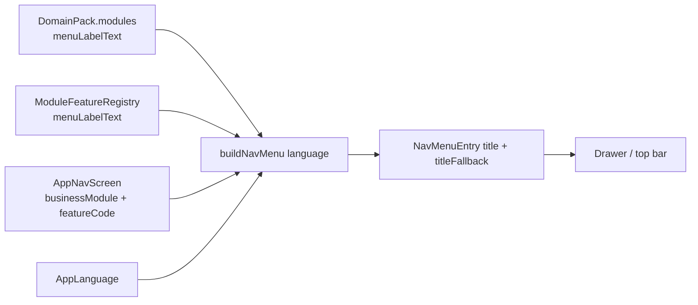

# TRD-I18N-003: Judul Menu dari Domain Pack dan Fitur Modul (`menuLabel`)

## 1. Document Context and Administration

- **Title & ID**: TRD-I18N-003 — Judul item menu dua bahasa dari data (`ModuleDefinition.menuLabelText`, `ModuleFeature.menuLabelText`)
- **Status**: Draf 1 untuk persetujuan · **Tanggal**: 2026-10-13 · **Pemilik**: Achmad Jamaludin
- **Induk**: [`TRD-I18N-002`](TRD-I18N-002-lokalisasi-data-pack.md) (P3) · **Plan**: [`PLAN-i18n-menu-label-in-pack.md`](../../plannings/features/PLAN-i18n-menu-label-in-pack.md)
- **Prioritas**: `features/`

### Revision History

| Versi | Tanggal | Penulis | Catatan |
|---|---|---|---|
| 0.1 | 2026-10-13 | Claude (atas permintaan Achmad) | Draf dari temuan cek visual P3 (drawer EN) |

### Summary & Business Context

Cek visual P3 (2026-10-13, persona Owner, `wemade-demo`, drawer ERP, EN) menunjukkan **judul seksi** berganti ke Inggris,
tetapi **nama item menu** tetap Indonesia. Item yang punya layar khusus memakai `AppNavScreen.title` (teks tetap di enum UI),
bukan data pack. Satu modul punya dua nama yang berbeda teks:

| `AppNavScreen.title` | `ModuleDefinition.displayName` |
|---|---|
| Bagan Organisasi | Bagan Struktur Organisasi & Karyawan |
| Gudang & Bahan Baku | Bahan Baku & Stok Kain |

Nama pack tidak bisa dipakai langsung: teks `id` drawer berubah (paritas rusak) dan lebih panjang. Di pack non-garment yang
memakai modul bersama (mis. `org_chart`) judul menu tetap bernada garment dan berbahasa Indonesia.

Layar tambahan modul multi-layar tampaknya adalah **fitur dalam modul** terdaftar (`ModuleFeature`, mewarisi RBAC induk;
module-integration-rules §5.4): `traceability` ↔ layar Telusur (induk `OPERATOR_EXEC`), `surat_jalan` ↔ layar Surat Jalan
(induk `FULFILLMENT`). **Belum terverifikasi** untuk seluruh layar (lihat §4 Asumsi).

### Stakeholders & Approvers
Product (Achmad), Tech Lead, QA, Developer.

### Goals (In-Scope)

- Field opsional `menuLabelText: LocalizedText?` pada `ModuleDefinition` (judul layar **utama** modul).
- Field opsional `menuLabelText: LocalizedText?` pada `ModuleFeature` (judul layar **fitur** di menu).
- `AppNavScreen` menunjuk fitur lewat `featureCode: String?` (konsep domain; bukan rute).
- `buildNavMenu` memakai: fitur → `menuLabelText` fitur; layar utama modul → `menuLabelText` modul; kosong → `displayNameText`
  modul; layar non-modul (login, builder) → `AppNavScreen.title`.
- Pack garment mengisi `menuLabel` dengan judul layar **saat ini** (teks `id` identik) + terjemahan `en`.
- Jalur validator kelengkapan terjemahan mencakup `menuLabel` (klaim `en` dibuktikan mesin).
- **Penandaan eksplisit tampil/tidak di menu** untuk setiap layar dan fitur: tipe `MenuPlacement` (`Shown` | `Hidden(alasan)`)
  sebagai **parameter wajib** (tanpa nilai bawaan) pada `AppNavScreen` dan `ModuleFeature`; kompilator memaksa keputusannya.
- **Aturan baku** di `module-integration-rules.md` §5.7 + `CLAUDE.md` §15: modul/fitur baru wajib menyiapkan menunya
  (tampil/tidak + judul `id`/`en`). Sudah ditulis 2026-10-13.
- **Inventaris** seluruh layar dan fitur: mana yang tampil, mana yang tersembunyi (+ alasan) — dibuat di Track 0.

### Non-Goals (Out-of-Scope)

- Memigrasi `ModuleFeatureRegistry` menjadi data pack (tahap sendiri; label fitur sementara tetap di registri mesin).
- Memecah modul multi-layar menjadi beberapa modul (menyentuh RBAC/kuota/entitlement).
- Mengubah judul layar non-modul (login, builder) — string UI Fase 1.
- Mengubah `displayName` pack atau teks `id` menu yang tampil sekarang.
- Penggambaran penanda `titleFallback` di drawer (data tersedia; render menyusul).

## 2. Functional Requirements

### F1 — Resolusi judul item menu (urutan tetap)
1. Layar dengan `featureCode` terdaftar → `feature.menuLabelText` bila ada.
2. Layar utama modul (satu-satunya layar tanpa `featureCode` untuk modul itu) → `module.menuLabelText` bila ada.
3. Selain itu → `module.displayNameText` (entri modul tanpa layar khusus) atau `AppNavScreen.title` (layar non-modul).
4. `resolve(bahasa)` → `ResolvedText`; `titleFallback = isFallback`. Tidak ada fallback senyap.
5. `featureCode` yang tidak terdaftar atau induknya tidak cocok dengan `businessModule` layar → **gagal** (invarian di tes
   dan pada konstruksi), bukan diabaikan.

### F2 — Data & codec
- `ModuleDefinition.menuLabelText` ditulis hanya bila ada (kunci `menuLabel`); pack lama terbaca seperti sebelumnya.
- Bahasa tak dikenal / `id` hilang / teks kosong → `DomainPackDecodeException` dengan path (parser `LocalizedTextCodec`).
- Pack id-saja tanpa `menuLabel` ter-encode **byte-identik** dengan sebelumnya.

### F3 — Identitas pack
`matchesShipped` dan `DomainPackRegistry.identityViolations` membandingkan **di luar** `menuLabel` (seperti terjemahan lain):
draf/pack lama tanpa `menuLabel` tetap sah terhadap garment yang kini memuatnya; menulis ulang `menuLabel` pada pack berkode
garment ditolak.

### F4 — Validator
`localizedTexts()` menambah jalur `modules[i].menuLabel`; pack yang mengklaim `en` tetapi punya `menuLabel` tanpa `en` gagal.
Label fitur dilaporkan oleh validator registri (tes), karena fitur belum bagian dari `DomainPack`.

### F6 — Penandaan tampil / tidak tampil (eksplisit)
- `MenuPlacement` = `Shown` | `Hidden(reason: String)` (sealed interface, `reason` wajib tak kosong). **Tanpa nilai bawaan**: tiap `AppNavScreen`
  dan tiap `ModuleFeature` harus menyatakannya. Menggantikan `isNavMenuItem: Boolean = true` (default diam-diam).
- `Shown` pada layar modul/fitur **mewajibkan** `menuLabelText` yang ada (layar utama: milik modul; layar fitur: milik fitur). Layar non-modul
  (login, builder) tetap `title`.
- `Hidden` wajib beralasan, mis. "layar anak, dibuka dari <induk>", "hanya lewat kanvas level 2", "tanpa layar khusus — lewat `/m/{code}`".
- Fitur tanpa layar sendiri (mis. `stage_frame`) = `Hidden("tampil di kanvas level 2 di bawah node induk")`.
- `buildNavMenu` hanya memasukkan `Shown` (perilaku `isNavMenuItem = true` sekarang) — hasil menu **identik**.
- Mode audit (`auditView`) tetap menampilkan entri terkunci; `Hidden` tidak pernah muncul di drawer.

### F5 — Pack lain
Pack tanpa `menuLabel` tetap tampil (memakai `displayNameText`); modul bersama (`org_chart`) mengikuti pack yang
menayangkannya.

## 3. Non-Functional Requirements (NFRs)

| Category | Requirement & Target Metrics | Rationale / Mitigation |
| :--- | :--- | :--- |
| **Performance** | `buildNavMenu` tetap fungsi murni O(modul); tanpa I/O | Resolusi di memori |
| **Scalability** | Penambahan ≤ 1 `LocalizedText` per modul/fitur; ukuran dokumen pack +<5% | Field opsional |
| **Security** | Teks dibersihkan/dibatasi `LocalizedText.MAX_LENGTH`; tidak ada perubahan RBAC | Fitur mewarisi gerbang modul induk |
| **Availability & Reliability** | Paritas: **semua judul menu `id` identik** sebelum/sesudah; pack lama terbaca | Tes iterasi `AppNavScreen` |
| **Maintainability & Observability** | Satu parser; tidak ada `else ->` baru; kompilator menandai titik pendaftaran | Kontrak 6 field-component-rules (semangat sama) |
| **UX/Layout** | Judul EN lebih panjang; drawer ±290dp harus melipat tanpa terpotong | Terverifikasi untuk judul seksi (melipat 2 baris) |

## 4. System Architecture & Technical Design

### High-Level Architecture

### Detailed Component Design

- `ModuleDefinition(…, menuLabelText: LocalizedText? = null)`; invarian: tidak ada (label `id` bebas, **bukan** cermin `displayName`).
- `ModuleFeature(…, menuLabelText: LocalizedText? = null)`; `hostModule` tetap operasional (invarian yang ada).
- `AppNavScreen(…, featureCode: String? = null)` — enum UI tetap; tes memastikan `featureCode` terdaftar dan `hostModule == businessModule`.
- `MenuPlacement` (core atau `presentation/navigation`; sealed interface): `Shown`, `Hidden(reason)`; `ModuleFeature.menu` dan `AppNavScreen.menu` wajib.
- `NavMenu.kt`: fungsi `menuTitle(screen, module, language)` (murni) menerapkan F1; `buildNavMenu` memfilter `menu is Shown`.
- `DomainPackCodec`: kunci opsional `menuLabel` pada objek modul.
- `PackTranslations.localizedTexts()`: jalur `modules[i].menuLabel`.
- `PackWithoutTranslations`/`PackIdTextEditing`: `menuLabelText` dipertahankan sebagai teks `id`-saja (tidak diterjemahkan, tidak dibuang).

### Data Model & Schema
Tanpa migrasi SQL: pack tersimpan sebagai dokumen JSONB; kunci `menuLabel` opsional. `module_catalog_entries` tidak berubah.

### API Specifications & External Contracts
Endpoint pack mengembalikan `menuLabel` hanya bila ada (objek `{id,en?}` atau string). Klien lama yang mengabaikan kunci tak dikenal
tidak terdampak; klien yang membaca pack ketat harus dicek di tes server (`DomainPackApiTest`).

### Technology Usage & Tradeoff Justification

| Pilihan | Alasan | Alternatif ditolak |
|---|---|---|
| `menuLabel` terpisah dari `displayName` | `id` identik; nama pendek untuk drawer, nama penuh untuk header | Memakai `displayName`: teks `id` berubah |
| Kunci = kode fitur | Konsep domain stabil, mewarisi RBAC induk | Kunci = rute layar: mencampur data dengan routing UI |
| Label fitur di registri mesin (sementara) | Registri belum data pack | Menunggu migrasi registri: menunda perbaikan menu |
| Field opsional | Kompatibel mundur, byte-identik | Field wajib: memaksa semua pack |

### Assumptions, Constraints, & Dependencies
- **Belum terverifikasi**: pemetaan seluruh layar ke fitur. Hanya `traceability` dan `surat_jalan` tampak cocok; layar lain
  (mis. Packing Bench, Daftar Pengiriman) mungkin belum punya fitur terdaftar → daftarkan fitur baru di registri atau biarkan
  memakai `AppNavScreen.title` (dicatat di Discovery).
- Tiga modul multi-layar saat ini: `FULFILLMENT`, `OPERATOR_EXEC`, `INVOICING` (layar kedua `INVOICING` disembunyikan dari menu).
- Registri fitur ada di `domain/pipeline` (paket mesin) dan berisi konten garment — utang yang sudah ada; dokumen ini tidak
  memperburuknya selain menambah satu field.
- `ModuleFeatureRegistry`, `RouteOwnershipTest`, dan kanvas level 2 memakai `displayName` fitur — tidak diubah.
- File besar (`GarmentModules.kt`, `DomainPackCodec.kt`, `NavMenu.kt`) tunduk Ratchet; catat `wc -l` sebelum/sesudah.

## 5. Testing, Deployment, and Operations

### Effort Estimation & Reasoning
- **Rating**: `Medium`.
- **Reasoning**: ±10 file produksi (`ModuleDefinition`, `ModuleFeature`, `AppNavScreen`, codec, `PackTranslations`,
  `PackWithoutTranslations`, `PackIdTextEditing`, `ShippedPackIdentity`, `GarmentModules` + tabel `en`, `NavMenu`), ±6 file tes,
  tanpa migrasi DB dan tanpa perubahan server selain serialisasi pack. Risiko: paritas judul `id` dan identitas pack garment.

### Parallel Execution Plan (Tracks)
- **Track 0 — Contract (serial)**: field `menuLabelText` (modul & fitur), `featureCode`, kunci kawat `menuLabel`, fungsi `menuTitle`,
  fixture pack lama + baru, `MenuPlacement` (parameter wajib), **inventaris layar & fitur tampil/tersembunyi + alasan**, keputusan pemetaan
  layar↔fitur (Discovery §4) dibekukan.
- **Track A — Core**: model, codec, validator, identitas pack, isi garment + `en`, tes paritas dan non-default.
- **Track B — Server**: serialisasi pack via codec, tes `DomainPackApiTest` (pack dengan/ tanpa `menuLabel`), 403 tulis pack tak berubah.
- **Track C — Client**: `AppNavScreen.featureCode`, `buildNavMenu`/`menuTitle`, tes `NavMenuTest` (paritas seluruh `AppNavScreen`).
- **Track D — Visual**: drawer id ↔ en (persona Owner), judul panjang melipat, `wemade-demo`; pack non-garment bila tenant uji ada.

### Technical Acceptance Criteria (AC)
1. Untuk **setiap** `AppNavScreen` ber-menu: judul `id` sebelum = sesudah (tes iterasi enum).
2. `en`: semua item modul garment satu-layar dan layar fitur terdaftar berjudul Inggris tanpa `titleFallback`.
3. Pack lama (tanpa `menuLabel`) terbaca dan ter-encode byte-identik; bahasa tak dikenal ditolak dengan path.
4. Draf garment id-saja tersimpan tetap lolos identitas; menulis ulang `menuLabel` pada pack berkode garment ditolak.
5. `featureCode` tak terdaftar / induk tak cocok → tes gagal.
6. Pack tanpa `menuLabel` menampilkan `displayNameText` (bukan kosong).
7. Setiap `AppNavScreen` dan `ModuleFeature` menyatakan `MenuPlacement` (kompilator memaksa); `Hidden` selalu beralasan; yang `Shown` punya
   label dua bahasa; daftar menu `Shown` **identik** dengan perilaku `isNavMenuItem = true` sebelum perubahan (tes iterasi).
8. Inventaris tampil/tersembunyi (§4 Lampiran) sesuai kode, dan dihasilkan/diperiksa tes (bukan tabel tulis tangan yang bisa basi).
9. Kompilasi 5 target hijau; `scripts/audit-variability.sh` tak menambah temuan; tanpa `else ->` baru.

### Testing Strategy
- Unit: `menuTitle` (urutan F1), codec (round-trip, kunci lama, bahasa tak dikenal), validator jalur `menuLabel`.
- Paritas: iterasi `AppNavScreen.entries` (judul `id`), pack garment dan pack non-default (fixture).
- Integrasi: `DomainPackApiTest` dengan pack berisi `menuLabel`.
- Visual: Track D (login Demo Mode superadmin → pilih persona Owner → buka `/org-chart` → drawer).

### Monitoring & Error Handling
- Laporan kelengkapan terjemahan (`translation-report`) otomatis memuat `modules[i].menuLabel`.
- Konstruksi gagal cepat untuk `featureCode` tak sah.

### Deployment & Rollback Plan
- Satu rilis; field opsional sehingga rollback = kembali ke pembaca lama (kunci `menuLabel` diabaikan).
- Kompilasi `compileKotlinJvm`, `compileKotlinWasmJs`, `compileKotlinJs`, `assembleAndroidMain`, `jvmTest` sebelum merge.

## Lampiran A — Inventaris tampil / tersembunyi (diisi Track 0; saat ini hanya angka terverifikasi)

Terverifikasi dari `AppNavScreen.kt` (2026-10-13): **10 layar** memakai `isNavMenuItem = false` (tersembunyi tanpa alasan tertulis), sisanya
tampil lewat nilai bawaan `true`. Rincian per layar dan alasannya **belum** ditulis — itu keluaran Track 0 (dibaca dari kode, lalu
dikunci tes). Fitur terdaftar saat ini: `stage_frame`, `optional_process`, `sample_storage`, `production_line`, `work_queue`,
`traceability`, `surat_jalan`; hanya sebagian punya layar sendiri.

| Entri | Status | Alasan | Label (`id` / `en`) |
|---|---|---|---|
| _(diisi Track 0 dari `AppNavScreen.entries` + `ModuleFeatureRegistry.all`)_ | Shown / Hidden | wajib bila Hidden | wajib bila Shown |

