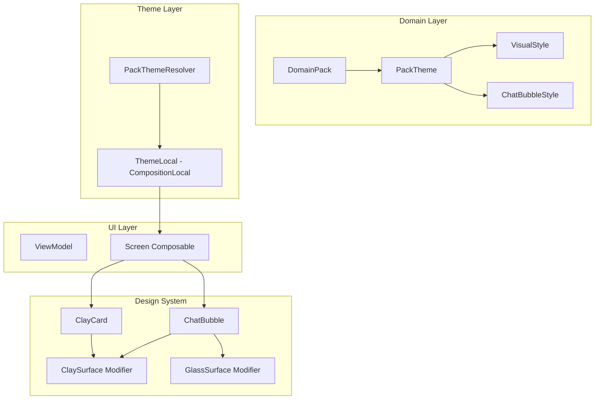

# TRD-PLAT-013: Pack Theme Customization — Visual Style per Tenant

## 1. Document Context and Administration

- **Title & Unique ID**: Pack Theme Customization — Visual Style per Tenant — `TRD-PLAT-013`
- **Revision History**

| Versi | Tanggal | Penulis | Catatan |
|---|---|---|---|
| 0.1 | 2026-10-14 | Achmad Jamaludin | Draft awal dari diskusi dengan Claude tentang glass design dan customization per tenant |

### Summary & Business Context

Platform WeMade ERP saat ini menggunakan **Claymorphism + Neo-Brutalism** sebagai bahasa visual default (outline tebal 3dp, hard shadow tanpa blur, sudut membulat besar). Namun:

1. **Kebutuhan bisnis**: Beberapa tenant/pack ingin menggunakan gaya visual berbeda — glass design (frosted glass), minimal, atau brutalist
2. **Use case chat + designer**: Menu chat untuk connect dengan designer membutuhkan gaya visual yang berbeda dari UI operasional factory flow
3. **Multi-tenant customization**: Setiap pack (FOB, CMT, Custom) harus bisa memiliki tema visual berbeda tanpa mengubah kode platform

Rujukan kode aktual:
- `DomainPack.kt` — struktur pack yang sudah ada (phases, slots, modules)
- `WeMadeTheme.kt` — theme tokens yang ada (`WeMadeColors`, `WeMadeLightColorScheme`)
- `ClayTokens.kt` — shape, offset, border, spacing tokens
- `ClayModifier.kt` — `claySurface()`, `clayFlat()`, `clayDashedOutline()`
- `ClayCard.kt`, `ClayButton.kt`, dll — komponen design system yang sudah ada

### Stakeholders & Approvers

Product & Tech Lead: Achmad Jamaludin · Implementasi: Claude (Jalur B) · QA: test visual di 2 tenant, cek glass effect, cek fallback ke clay

### Goals (In-Scope)

- **T1 Pack Theme Config**: Tambah field `theme: PackTheme?` di `DomainPack` untuk konfigurasi visual per pack
- **T2 Visual Styles**: Definisikan enum `VisualStyle` (CLAY, GLASS, MINIMAL, BRUTAL) dan `ChatBubbleStyle` (CARD, BUBBLE, GLASS)
- **T3 Theme-Aware Components**: Component UI (ChatBubble, Card, Button) menerima theme config dan render sesuai style
- **T4 Glass Effect Implementation**: Implementasi glassmorphism effect (backdrop blur, transparency, subtle border)
- **T5 Tenant Resolution**: Theme di-resolve dari pack tenant saat runtime

### Non-Goals (Out-of-Scope)

- **Di luar scope**: Dark mode implementation (sudah ada di WeMadeColors sebagai token, tapi bukan fitur ini)
- **Di luar scope**: Custom font loading per tenant (belum ada kebutuhan)
- **Di luar scope**: Runtime theme switcher UI untuk end-user (bukan self-service, admin only via pack)

---

## 2. Functional Requirements

### T1 Pack Theme Configuration

- **FR-T1-1**: `DomainPack` wajib punya field `theme: PackTheme?` (nullable untuk backward compatibility pack lama)
- **FR-T1-2**: `PackTheme` berisi:
  - `style: VisualStyle` — enum (CLAY, GLASS, MINIMAL, BRUTAL)
  - `accentColorHex: Long?` — warna aksen kustom (null = default dari WeMadeColors)
  - `chatBubbleStyle: ChatBubbleStyle` — enum (CARD, BUBBLE, GLASS)
  - `cardStyle: CardStyle?` — optional override untuk card appearance
- **FR-T1-3**: Pack garment (FOB, CMT) default ke `style = VisualStyle.CLAY` (null-safe)

### T2 Visual Style Definitions

```kotlin
enum class VisualStyle {
    CLAY,       // default: claymorphism + neo-brutalism
    GLASS,      // glassmorphism: frosted glass, blur, transparency
    MINIMAL,    // flat, clean, minimal decoration
    BRUTAL      // neo-brutalist: bold, high contrast
}

enum class ChatBubbleStyle {
    CARD,       // ClayCard style dengan shadow
    BUBBLE,     // rounded bubble tanpa shadow
    GLASS       // glassmorphism bubble
}
```

### T3 Theme-Aware Components

- **FR-T3-1**: Component UI menerima `theme: PackTheme` sebagai parameter atau dari composition local
- **FR-T3-2**: `ChatMessageBubble` support 3 style: CARD (existing), BUBBLE (new), GLASS (new)
- **FR-T3-3**: Component hanya consume theme config — tidak ada business logic di view layer

### T4 Glass Effect Implementation

- **FR-T4-1**: `Modifier.glassSurface()` extension function yang implement:
  - `backdropFilter` dengan blur 20-40px
  - `background` dengan opacity 0.1-0.3
  - subtle border dengan white alpha
- **FR-T4-2**: Glass effect hanya aktif bila `style == VisualStyle.GLASS`
- **FR-T4-3**: Fallback ke `claySurface()` bila bukan glass style

### T5 Tenant Theme Resolution

- **FR-T5-1**: `PackThemeResolver` service yang resolve theme dari:
  1. Tenant's domain pack theme config
  2. Fallback ke platform default (CLAY)
- **FR-T5-2**: Theme di-inject via CompositionLocal ke subtree yang butuh

---

## 3. Non-Functional Requirements

| Category | Requirement & Target Metrics | Rationale / Mitigation |
| :--- | :--- | :--- |
| **Performance** | Glass effect render < 16ms (60fps). Blur expensive — use sparingly, only on surfaces | Test with profile mode; fallback to solid if laggy |
| **Scalability** | Theme config di-pack JSON (already cached). No runtime DB query | Pack resolution already cached in memory |
| **Security** | Color values dari pack JSON — validate hex format (6-8 digit) | Pack validator already exists |
| **Availability & Reliability** | Null-safe fallback ke CLAY style bila theme null | Pack lama tetap works |
| **Maintainability** | Theme logic di theme layer, tidak di component individual | Satu source of truth |

---

## 4. System Architecture & Technical Design

### High-Level Architecture



### Component Design

#### PackTheme Data Class

```kotlin
// di core/src/commonMain/kotlin/com/eventverse/app/domain/pack/PackTheme.kt

data class PackTheme(
    val style: VisualStyle = VisualStyle.CLAY,
    val accentColorHex: Long? = null,
    val chatBubbleStyle: ChatBubbleStyle = ChatBubbleStyle.CARD,
    val cardStyle: CardStyle? = null
)

enum class VisualStyle {
    CLAY,       // default: claymorphism
    GLASS,      // glassmorphism
    MINIMAL,    // flat design
    BRUTAL      // neo-brutalist
}

enum class ChatBubbleStyle {
    CARD,       // ClayCard variant
    BUBBLE,     // Simple rounded bubble
    GLASS       // Glassmorphism bubble
}

enum class CardStyle {
    DEFAULT,    // ClayCard standard
    ELEVATED,   // More prominent shadow
    FLAT        // No shadow, just border
}
```

#### Theme Resolver

```kotlin
// di core/src/commonMain/kotlin/com/eventverse/app/domain/pack/PackThemeResolver.kt

class PackThemeResolver(
    private val packRegistry: DomainPackRegistry
) {
    fun resolve(tenantId: TenantId): PackTheme {
        val effectivePack = packRegistry.findEffective(tenantId)
        return effectivePack.theme ?: PackTheme() // fallback to CLAY default
    }
}
```

#### Glass Surface Modifier

```kotlin
// di app/shared/src/commonMain/kotlin/com/eventverse/app/presentation/designsystem/GlassModifier.kt

fun Modifier.glassSurface(
    shape: Shape = RoundedCornerShape(16.dp),
    backgroundColor: Color = Color.White.copy(alpha = 0.2f),
    borderColor: Color = Color.White.copy(alpha = 0.3f),
    blurRadius: Dp = 25.dp,
    saturation: Float = 1.8f
): Modifier = this
    .graphicsLayer {
        this.renderEffect = RenderEffect
            .createBlurEffect(blurRadius.toPx(), blurRadius.toPx(), BlurEdgeTreatment.Compact)
            .asComposeRenderEffect()
    }
    .background(backgroundColor, shape)
    .border(1.dp, borderColor, shape)
```

#### ChatBubble with Theme Support

```kotlin
@Composable
fun ChatBubble(
    message: ChatMessage,
    theme: PackTheme,
    modifier: Modifier = Modifier,
    onApply: () -> Unit = {},
    onShowResult: () -> Unit = {}
) {
    when (theme.chatBubbleStyle) {
        ChatBubbleStyle.CARD -> ClayChatBubble(message, theme, modifier, onApply, onShowResult)
        ChatBubbleStyle.BUBBLE -> BubbleChatBubble(message, theme, modifier, onApply, onShowResult)
        ChatBubbleStyle.GLASS -> GlassChatBubble(message, theme, modifier, onApply, onShowResult)
    }
}
```

### Data Flow

1. **Pack Loading**: `DomainPackRegistry.findEffective(tenantId)` return pack dengan theme config
2. **Theme Resolution**: `PackThemeResolver.resolve(tenantId)` extract theme dari pack
3. **Composition Local**: Theme di-provide via `CompositionLocal<PackTheme>` ke subtree
4. **Component Render**: Component baca theme dari Local, render sesuai style

### Dependencies

- **Existing**: `DomainPack`, `DomainPackRegistry` — sudah ada
- **Existing**: `WeMadeColors`, `ClayTokens` — sudah ada
- **New**: `PackTheme`, `VisualStyle`, `ChatBubbleStyle` — perlu dibuat
- **New**: `PackThemeResolver` — service baru
- **New**: `GlassModifier` — extension baru

---

## 5. Testing, Deployment, and Operations

### Effort Estimation & Reasoning

- **Rating**: `Medium`
- **Reasoning**: Perlu menambah data class di domain pack (1-2 file), theme resolver service (1 file), glass modifier (1 file), dan 2-3 variant component (ChatBubble). Tidak ada migrasi DB. Estimasi: 1-2 sprint.

### Parallel Execution Plan (Tracks)

- **Track 0 — Contract Phase**: Definisikan `PackTheme`, `VisualStyle`, `ChatBubbleStyle` di domain layer. Tidak ada DB migration.
- **Track A — Core & Domain**: Implementasi `PackThemeResolver`, validasi pack dengan theme.
- **Track B — Server**: Tidak ada server changes (theme config di pack JSON, bukan runtime DB)
- **Track C — Client & UI**: Implementasi `GlassModifier`, `ChatBubble` variants, CompositionLocal setup.
- **Track D — Visual Check**: Test glass effect di browser, cek performance, fallback ke clay di perangkat lambat.

### Technical Acceptance Criteria

- [ ] Pack garment FOB punya `theme = PackTheme(style = GLASS)` render glass effect
- [ ] Pack garment CMT (tanpa theme config) fallback ke CLAY style
- [ ] ChatBubble CARD style sama dengan existing `ChatMessageBubble`
- [ ] ChatBubble GLASS style render frosted glass effect
- [ ] Glass effect render dalam 16ms (60fps)
- [ ] Null theme tidak crash, fallback ke CLAY

### Testing Strategy

1. **Unit Test**: `PackThemeResolver` resolve correct theme dari pack
2. **Visual Test**: Screenshot test untuk 3 ChatBubble styles di 2 theme (CLAY, GLASS)
3. **Performance Test**: Frame timing measurement untuk glass effect

### Monitoring & Error Handling

- Theme resolution error → fallback ke `PackTheme()` (CLAY default)
- Glass effect not supported (某些 perangkat) → graceful fallback ke solid

### Deployment & Rollback

- Pack JSON schema update — backward compatible (nullable fields)
- No database migration needed
- Rollback: revert code change, theme fallback works automatically

---

## 6. Referensi Desain Visual

### Glassmorphism Parameters

| Element | Value | Notes |
|---|---|---|
| Background | rgba(255,255,255, 0.15-0.25) | Semi-transparent white |
| Backdrop blur | 20-40px | Depends on surface importance |
| Border | 1px solid rgba(255,255,255, 0.3) | Subtle light border |
| Saturation | 180% | Boost color after blur |
| Shadow | None or very subtle | Glass has "depth" via blur |

### Style Comparison

| Style | Border | Shadow | Corner Radius | Background |
|---|---|---|---|---|
| CLAY | 3dp thick | 6dp hard | 12-24dp | Solid |
| GLASS | 1dp subtle | None | 16-24dp | Transparent + blur |
| MINIMAL | 1dp light | None | 8-12dp | Solid light |
| BRUTAL | 3-4dp bold | 4-6dp hard | 0-8dp | Solid bold |
