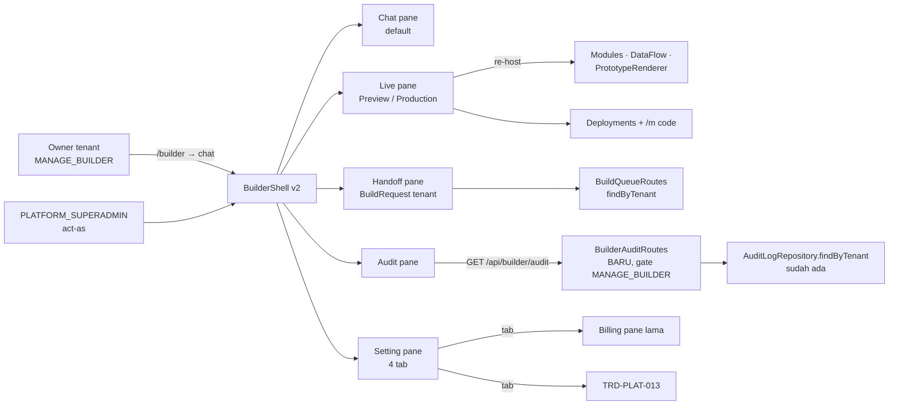

# TRD-PLAT-014: Builder Console v2 — Navigasi Assisted-Serve (Chat, Live, Handoff, Audit, Setting)

## 1. Document Context and Administration

- **Title & Unique ID**: Builder Console v2 — Navigasi Assisted-Serve — `TRD-PLAT-014`
- **Revision History**

| Versi | Tanggal | Penulis | Catatan |
|---|---|---|---|
| 0.1 | 2026-10-14 | Achmad Jamaludin (dibantu Claude) | Dari sesi desain menu 2026-10-14; melengkapi [`TRD-PLAT-002-builder.md`](TRD-PLAT-002-builder.md) (M0–M2 selesai) |
| 0.2 | 2026-10-14 | Achmad Jamaludin (dibantu Claude) | **Track 0 dibekukan**: kontrak menu/route/badge di `core/.../domain/builder/BuilderConsoleContract.kt`, kontrak JSON audit di `core/.../shared/builder/BuilderAuditTrailCodec.kt`, test kontrak `BuilderConsoleContractTest` + `BuilderAuditTrailCodecTest` |

### Summary & Business Context

Builder Console hari ini punya 10 menu (`BuilderShell.builderMenu()`: overview, newpack, chat, modules,
dataflow, prototype, buildqueue, deployments, billing, settings). Itu struktur "konsol teknis" — meniru
Vercel per fitur mesin, bukan per moment pelanggan.

Model bisnis kalian bukan Lovable (owner memelihara aplikasinya sendiri), melainkan **assisted-serve**:
owner bercerita → platform membangun prototype sesuai keinginannya → prototype disambungkan ke modul
standar → developer yang kalian punya mengeksekusi sisanya. Navigasi v2 menegaskan model itu dengan
**lima menu berorientasi peran**: Chat, Live, Handoff, Audit, Setting. Audit adalah pembeda kompetitif
yang ditegaskan secara eksplisit: modul hasil Prototype hidup dengan **standar security platform yang
sama** (RBAC fail-closed, RLS, entitlement, audit trail) — hal yang tidak dimiliki Lovable/Replit.

### Stakeholders & Approvers

Product & Tech Lead: Achmad Jamaludin · Implementasi: Claude (Jalur B) · QA: test 403 per endpoint,
cek visual `wemade-demo` + `bordir-uji`

### Goals (In-Scope)

1. **Chat sebagai pintu masuk** — `/builder` (tanpa segmen) membuka Chat langsung; `newpack` turun
   menjadi aksi di empty-state chat (route lama tetap hidup).
2. **Live** — satu pane dua tab: **Preview** (re-host Prototype + Modules + Data Flow; wireframe Moqups)
   dan **Production** (deployment aktif, status modul live, tautan `/m/{code}`, riwayat + rollback ringkas;
   konten Overview lama menempel di header tab ini).
3. **Handoff** — jendela owner atas Antrian Pembuatan milik tenantnya: `BuildRequest` + brief beku +
   status (QUEUED…SHIPPED) + quote/ETA. Papan lintas tenant tetap milik superadmin (tidak berubah).
4. **Audit** — pane baru di atas `AuditLogRepository.findByTenant` yang sudah ada: jejak perubahan
   (deploy/rollback, act-as, konfirmasi billing, berbagi pack, patch diterapkan) per tenant; superadmin
   melintasi tenant. Tidak ada infrastruktur audit baru — hanya endpoint baca + UI.
5. **Setting** — Pengaturan lama melebar jadi tab: Identitas Bisnis, Pack & Tema (jembatan ke
   [`TRD-PLAT-013`](TRD-PLAT-013-pack-theme-customization.md)), Tagihan (Billing lama pindah ke sini),
   Kolaborator.

### Non-Goals (Out-of-Scope)

- Portal developer penuh (`PLAN-developer-portal-software-house.md` C1–C6: peran `DEVELOPER`, penugasan,
  keuangan software house). Menu Handoff di sini **halah sisi owner/klien**; portal developer adalah
  rencana terpisah.
- Produksi kode modul otomatis dari prototype (agent hanya mengusulkan — Kontrak TRD-PLAT-002 tetap).
- Log audit baru atau perubahan semantik audit — pane ini hanya **membaca** yang sudah dicatat.
- Billing iPaymu self-service (tetap L1), custom domain (L2).
- Menyatukan menu admin superadmin (`/admin`) — papan lintas tenant tetap di tempatnya.

## 2. Functional Requirements

### FR-1 Navigasi & Shell

- **FR-1-1 Default route**: `/builder` membuka pane Chat (hari ini: overview). `BuilderShell(section =
  "overview")` default berubah; deep-link `/builder/overview` dialihkan ke `/builder/live/production`
  (redirect klien, tanpa 404).
- **FR-1-2 Menu baru**: `builderMenu()` menjadi 5 entri: `chat`, `live`, `handoff`, `audit`, `setting`
  (dengan ikon `designsystem/` yang ada). Route lama `modules`, `dataflow`, `prototype`, `deployments`,
  `billing`, `buildqueue`, `newpack` tetap valid (deep-link/backward-compat) dan memetakan ke lokasi baru:
  `modules|dataflow|prototype` → `live/preview`; `deployments` → `live/production`; `billing` →
  `setting/billing`; `buildqueue` → `handoff`; `newpack` tetap layar sendiri dari aksi chat.
- **FR-1-3 Label dua bahasa** untuk entri menu baru (id + en) sebagai data (pola TRD-I18N-003); entri lama
  mengikuti utang inventaris TRD-I18N-003, tidak diperluas di sini.
- **FR-1-4 Badge**: `handoff` menampilkan badge jumlah `BuildRequest` aktif (QUEUED/QUOTED/APPROVED/
  IN_PROGRESS) milik tenant; `live` menampilkan titik status deployment (`ACTIVE`/`BLOCKED_ON_BUILD`).

### FR-2 Chat (pintu masuk)

- **FR-2-1** Pane chat tidak berubah perilaku (TRD-PLAT-002 M1); hanya menjadi default.
- **FR-2-2** Empty-state chat memuat aksi "Buat Pack Baru" (membuka `newpack`) dan ringkasan deployment
  aktif satu baris (pakai data overview lama).

### FR-3 Live (Preview | Production)

- **FR-3-1 Tab Preview**: meng-host `BuilderModulesPane`, `BuilderDataFlowPane`, `PrototypeRenderer`
  sebagai sub-seksi/tab internal; wireframe Moqups tetap interaktif (teaching-moqups-wireframe-flow-builder).
- **FR-3-2 Tab Production**: header status (TRIAL/LIVE, deployment aktif v N, pack+versi ter-pin,
  tombol Deploy/Rollback untuk TENANT_ADMIN); daftar modul live dengan tautan `/m/{code}`; modul
  "perlu dibangun" menaut ke Handoff.
- **FR-3-3** Transisi Preview→Production eksplisit: dari Preview tersedia tombol "Lihat di Production"
  yang membuka tab Production (dan sebaliknya), karena keduanya membaca dua dunia berbeda
  (draf vs runtime) dan tidak boleh tertukar diam-diam.

### FR-4 Handoff (Antrian Pembuatan sisi owner)

- **FR-4-1** Daftar `BuildRequest` **milik tenant pemanggil saja** (`findByTenant`); antrean lintas tenant
  tetap hanya di `/admin` superadmin.
- **FR-4-2** Setiap baris: modul, alasan, status (`QUEUED, QUOTED, APPROVED, IN_PROGRESS, SHIPPED,
  REJECTED, SUPERSEDED`), quote/ETA bila ada, penunjuk brief beku (Markdown) yang bisa dibuka.
- **FR-4-3** Membaca brief tercatat di audit log (pola "audit baca brief", prasyarat C1 portal developer).
- **FR-4-4** Gate `MANAGE_BUILDER`; baca tetap fail-closed (keputusan RBAC tak bisa dihitung → 403).

### FR-5 Audit

- **FR-5-1 Endpoint baca baru** `GET /api/builder/audit?limit=` — mengembalikan entri
  `AuditLogRepository.findByTenant(tenantId, limit)` untuk tenant sesi; gate `MANAGE_BUILDER`.
- **FR-5-2 Pane**: daftar kronologis (aksi, aktor, waktu, ringkasan) + filter per jenis aksi;
  superadmin memilih tenant (pola act-as/`X-Tenant-Slug` yang ada).
- **FR-5-3 Kartu "Postur Security"** di kepala pane (hanya tampilan data yang sudah ada, bukan audit baru):
  status deployment aktif + versi ter-pin, jumlah modul live dengan RBAC terdaftar vs total, tanggal
  rollback terakhir. Ini yang menegaskan janji "modul standar security-nya platform".

### FR-6 Setting

- **FR-6-1 Tab Identitas Bisnis**: isi Pengaturan lama (logo, NPWP, prefiks nomor dokumen).
- **FR-6-2 Tab Pack & Tema**: pack aktif + versi ter-pin (read-only; ganti pack tetap lewat chat/deploy),
  jembatan ke kustomisasi tema TRD-PLAT-013 bila sudah terpasang.
- **FR-6-3 Tab Tagihan**: pane Billing lama dipindahkan ke sini; route `/builder/billing` redirect.
- **FR-6-4 Tab Kolaborator**: undangan/daftar user dengan `MANAGE_BUILDER` (sudah ada).

## 3. Non-Functional Requirements (NFRs)

| Category | Requirement & Target Metrics | Rationale / Mitigation |
| :--- | :--- | :--- |
| **Performance** | Pane Live lazy-load per tab; audit baca default 50 entri (batas `findByTenant`); badge menu dari state yang sudah dimuat | Hindari memuat wireframe + deployment + audit sekaligus saat buka `/builder` |
| **Scalability** | Tidak ada tabel baru; endpoint audit memakai repositori yang ada + indeks `tenant_id` (verifikasi saat Track B) | Perubahan struktur minimal, risiko rendah |
| **Security** | Semua endpoint tetap gate `MANAGE_BUILDER` fail-closed; audit pane tidak mengekspos payload chat (log sudah tanpa payload); owner hanya lihat tenant sendiri; test 403 per endpoint tulis/baca baru (termasuk user tanpa izin dan tenant lain) | Audit adalah fitur kepercayaan — bocor = klaim security gugur |
| **Availability & Reliability** | Pane Audit/Handoff gagal memuat → empty-state jujur + retry, tidak mematikan shell; redirect route lama tidak pernah 404 | Navigasi v2 tidak boleh mematahkan deep-link lama |
| **Maintainability & Observability** | Re-host pane lama tanpa menulis ulang isinya (komposisi, bukan salin); `BuilderShell.kt` ≤600 baris (hard limit presentation); label menu dua bahasa sebagai data; kompilasi 5 target | Aturan Tiga Kali & file-size-rules; hindari duplikasi pane |

## 4. System Architecture & Technical Design

### High-Level Architecture

### Detailed Component Design

- **Tanpa domain baru.** Ini rencana navigasi + komposisi + satu endpoint baca. Use case baru maksimal
  satu: `GetBuilderAuditTrailUseCase` (pembungkus tipis `findByTenant` + pemetaan ke UI model) — bila
  dianggap terlalu tipis, route boleh memanggil repositori langsung mengikuti pola route admin yang ada.
- **Klien**:
  - `BuilderShell.kt`: `builderMenu()` 5 entri + pemetaan route lama → baru (redirect).
  - `presentation/builder/live/BuilderLivePane.kt` (tab host) — sub-seksi memakai komponen pane lama
    apa adanya; `BuilderProductionPane.kt` (baru, dari materi Overview + Deployments lama).
  - `presentation/builder/handoff/BuilderHandoffPane.kt` (dari pane buildqueue lama, scope tenant).
  - `presentation/builder/audit/BuilderAuditPane.kt` + `BuilderAuditViewModel` (MVI, fake di test).
  - `presentation/builder/setting/BuilderSettingPane.kt` (tab host; hosting pane lama).
  - `infrastructure/api/BuilderApiClient.kt` + `builderAudit()`; badge handoff dari endpoint yang ada.
- **Server**: `server/routes/BuilderAuditRoutes.kt` (baru) didaftarkan di `ServerRouteWiring`
  (pola F1 TRD-PLAT-002); tidak menyentuh `Application.kt`.

### Data Model & Schema

- **Tidak ada migrasi.** Tabel yang dipakai sudah ada: `builder.deployments`, `builder.build_requests`,
  `ops.discovery_drafts`, audit log (lihat `PostgresAuditLogRepository`).
- Verifikasi Track B: pastikan tabel audit punya indeks pada kolom tenant-nya (tambahkan lewat migrasi
  additif hanya bila ternyata belum ada — catat nomor migrasi berjalan saat implementasi).

### API Specifications

| Method & Path | Gate | Catatan |
|---|---|---|
| `GET /api/builder/audit?limit=50` | `MANAGE_BUILDER` | **Baru**; entri audit tenant sesi; superadmin act-as → tenant target; limit diklem ≤200 |
| `GET /api/builder/build-requests` | `MANAGE_BUILDER` | Ada (TRD-PLAT-002); kini juga dipakai pane Handoff + badge |
| `GET /api/builder/deployments` | `MANAGE_BUILDER` | Ada; dipakai tab Production |
| `POST /api/builder/chat`, `/apply` | `MANAGE_BUILDER` | Tidak berubah |

Semua baca fail-closed: keputusan RBAC tidak bisa dihitung → 403; user tenant lain → 403.

### Technology Usage & Tradeoff Justification

- **5 menu alih-alih 10**: menu lama memetakan mesin (per fitur), menu baru memetakan momen pelanggan
  (bicara → lihat → serahkan → percaya → atur). Deep-link lama dipertahankan lewat redirect supaya
  teaching doc dan refleks pengguna tidak patah.
- **Re-host, bukan tulis ulang**: pane Modules/Data Flow/Prototype/Billing dipindah sebagai komposisi;
  menyalinnya akan melanggar Aturan Tiga Kali dan menggandakan utang file size.
- **Audit tanpa infrastruktur baru**: `findByTenant` sudah ada dan dipakai papan admin; pane ini hanya
  memperluas keterbacaan ke owner — klaim security jadi bisa dilihat sendiri oleh klien.
- **Handoff dibatasi sisi owner**: papan lintas tenant tetap superadmin (PLAN-developer-portal C1 —
  akses per penugasan — belum dibangun; jangan bocorkan antrean orang lain ke owner).

### Assumptions, Constraints, & Dependencies

- TRD-PLAT-002 M0–M2 sudah jalan di kode (chat, deploy, rollback, build queue, billing manual) —
  status implementasi di plan tersebut.
- `PLAN-developer-portal-software-house.md` tetap rencana terpisah; menu Handoff tidak menunggu C1–C6.
- Tema TRD-PLAT-013 mungkin belum terpasang saat v2 dibangun — tab Pack & Tema menampilkan status
  "belum tersedia" jujur, bukan dipalsukan.
- Label dua bahasa mengikuti mekanisme data TRD-I18N-003; bila mekanisme label menu builder belum ada,
  kirim string id+en bersama entri menu (data, bukan hardcoded di composable).

## 5. Testing, Deployment, and Operations

### Effort Estimation & Reasoning

- **Rating**: **Low–Medium** — mayoritas komposisi UI + redirect + satu endpoint baca; tanpa migrasi
  skema (kecuali indeks audit bila belum ada); tidak ada domain baru; risiko terbesar ada pada
  pemetaan route lama dan disiplin file-size shell.

### Parallel Execution Plan (Tracks)

- **Track 0 — Contract (serial, prasyarat)**: bekukan daftar menu + peta route lama→baru (tabel FR-1-2),
  kontrak JSON `GET /api/builder/audit`, label id+en kelima menu, dan definisi badge.
- **Track A — Core & Domain**: (tipis) `GetBuilderAuditTrailUseCase`/UI model bila dipakai; test unit
  pemetaan route & pemilihan badge dari fixture.
- **Track B — Server & Persistence**: `BuilderAuditRoutes` + wiring di `ServerRouteWiring`; test gate
  403 (tanpa izin, tenant lain, keputusan tak terhitung); verifikasi/penambahan indeks audit bila perlu.
- **Track C — Client & UI**: BuilderShell v2 + redirect; pane Live (re-host), Handoff, Audit, Setting
  (tab host); ApiClient; ViewModel + test unit dengan fake.
- **Track D — Visual Check**: `/builder` login owner `bordir-uji` dan superadmin `wemade-demo`, lebar
  ~1280dp; deep-link lama (`/builder/deployments`, `/builder/billing`, …) tetap sampai tujuan;
  kepatuhan Clay (nol literal warna baru).

### Technical Acceptance Criteria (AC)

- **AC-1**: `/builder` membuka Chat; kelima menu tampil dengan badge yang benar; deep-link lama semua
  ter-redirect tanpa 404.
- **AC-2**: Live:Preview menampilkan Modules+Data Flow+Prototype identik perilaku lama; Live:Production
  menampilkan deployment aktif + tautan `/m/{code}`; modul "perlu dibangun" menaut ke Handoff.
- **AC-3**: Handoff menampilkan `BuildRequest` tenant sendiri saja — permintaan tenant lain **tidak
  pernah** muncul (test dua tenant); brief beku terbaca dan pembacaannya tercatat audit.
- **AC-4**: `GET /api/builder/audit` mengembalikan ≤limit entri tenant sesi; tanpa `MANAGE_BUILDER` →
  403; user tenant lain → 403; superadmin act-as → entri tenant target.
- **AC-5**: Setting empat tab; Billing lama berfungsi identik dari lokasi baru.
- **AC-Umum**: kompilasi 5 target hijau; `BuilderShell.kt` dan semua pane baru ≤600 baris;
  `scripts/audit-variability.sh` tanpa temuan baru; nol literal warna baru di luar `WeMadeTheme.kt`.

### Testing Strategy

- **Server**: route gate test pola `RouteGateTest` untuk endpoint audit baru (403 × 3 kasus, 200 kasus sah,
  limit diklem); test redirect bukan tanggung jawab server (klien).
- **Klien (jvmTest)**: ViewModel audit/handoff dengan fake; pemetaan route lama→baru (tabel FR-1-2)
  diiterasi sebagai test supaya entri baru tidak bisa lupa redirect.
- **Visual**: Track D di atas — dicek mata setelah login (bukan "belum login"); dua tenant.

### Monitoring & Error Handling

- Gagal memuat audit/handoff → empty-state + retry per pane; shell tetap hidup.
- Endpoint audit hanya membaca — tidak ada jalur tulis baru yang perlu dipantau; log terstruktur route
  tetap mencatat `tenantId`, endpoint, keputusan gate.

### Deployment & Rollback Plan

- Satu–dua PR kecil (Track B+C bisa satu PR bila Track 0 beku); tanpa migrasi berisiko.
- Rollback aplikasi: revert PR; redirect route lama membuat perilaku lama mudah dipulihkan.
- Teaching doc wajib setelah selesai (AGENTS.md §12) + `graphify update .`; tutup checklist di plan
  (AGENTS.md §18: flag + `TASKS-SUMMARY.md`).
