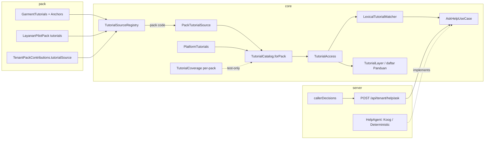
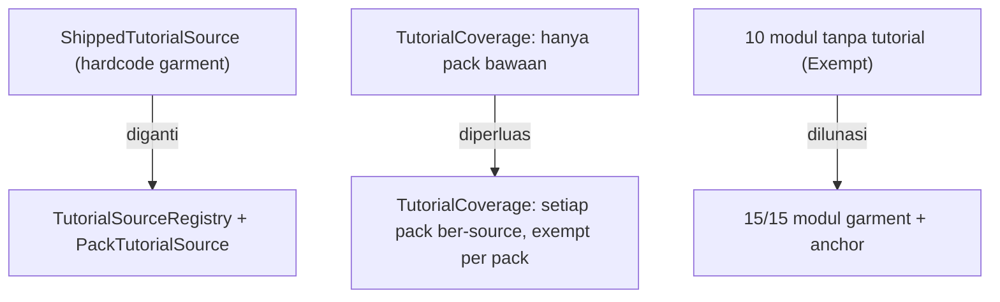

# TRD-TUT-001: Cakupan Tutorial per Modul & Pack (Per-Tenant Tutorials)

> **Keluarga `TUT`** — dokumen ini **dipindahkan** dari `TRD-HELP-003` (2026-10-15) agar batas domainnya jujur:
> engine tutorial (`core/.../domain/tutorial/`, `presentation/tutorial/`) terpisah dari chat helper
> (`core/.../domain/help/`, `presentation/help/`). **`HELP` tetap untuk agent/chat** (dan kelak RAG);
> **`TUT` untuk tutorial & coach mark**.
> **Penerus**: [`PLAN-help-003`](../../plannings/features/PLAN-help-003-tutorial-coverage-contract.md) (kontrak cakupan, **selesai**),
> [`TRD-HELP-001`](TRD-HELP-001-module-tutorials.md) (mesin Fase 1–4 + FR-8),
> [`TRD-TUT-002`](TRD-TUT-002-interactive-coach-mark.md) (tutorial interaktif / spotlight tembus).

## 0. Discovery Note (ringkas)

**Tanggal**: 2026-10-15 · **Penulis**: Achmad Jamaludin (dibantu Kilo)

- **Siapa memakai**: semua pengguna tenant — staf modul, admin pabrik, dan (khusus Builder) pemegang `MANAGE_BUILDER`.
  Yang diuntungkan: pengguna tenant non-garment (hari ini **nol** tutorial modul) dan pengguna 10 modul garment yang belum bercoach-mark.
- **Data milik siapa**: platform/pack. Isi tutorial ditulis developer dan dirilis bersama kode pack, **bukan** data tenant
  (keputusan HELP-001 §0.4 tetap). Tutorial pack tenant hidup di pohon kode pack itu (J3), bukan di DB.
- **Kapan berubah**: per rilis pack, saat UI modul berubah atau modul baru dipasangi anchor.
- **Jenis**: fitur lintas modul (bukan `BusinessModule`) — mengikuti HELP-001 §0.3. Tidak dijual, tidak dihitung kuota,
  mewarisi RBAC modul yang dituju, tanpa node kanvas.
- **Konsumen hilir**: chat helper (`/api/tenant/help/ask`) memakai katalog yang sama. TRD ini **tidak** mengubah kontrak chat;
  ia memastikan katalog yang dibaca helper lengkap untuk setiap modul & pack.

### 0.2 Fitur serupa

Perintah: `scripts/find-similar-feature.sh tutorial panduan bantuan help coachmark`
→ **sudah ada**: `core/.../domain/tutorial/` + `core/.../domain/help/` (HELP-001 Fase 1–4) dan
`TutorialCoverage` (PLAN-help-003). **Keputusan: perluas mesin tutorial yang ada, bukan fitur baru** — yang kurang adalah
*isi* (tutorial per modul) dan *mekanisme per-pack* (pack tenant), bukan mesin.

### 0.3 Uji Variabilitas

| Konsep | Beda per tenant? | Per industri/pack? | Admin ubah? | → Kode / Data | Catatan |
|---|---|---|---|---|---|
| Isi tutorial (judul, langkah, kata kunci) | Tidak | **Ya** | Tidak | **Data per DomainPack** (kode pack) | Tidak disalin ke tenant, tidak dibekukan |
| Keberadaan tutorial untuk setiap modul pack | Tidak | Tidak | Tidak | **Kode** (kontrak, ditegakkan test) | Diperluas ke pack data di TRD ini |
| Anchor (`TutorialAnchorId`) | Tidak | Tidak | Tidak | **Kode** (konstanta per pack) | Anchor yang hilang tetap terdegradasi ke `CENTER` |
| Mekanisme resolusi tutorial per pack | Tidak | Tidak | Tidak | **Kode** (registry) | Menggantikan hardcode `garment` di `ShippedTutorialSource` |
| Sumber tutorial pack tenant | Tidak | Ya | Tidak | **Data di pack tenant** (J3) | Didaftarkan lewat `TenantPackContributions` |

**Konsekuensi**: tutorial tetap **data rilis pack**, bukan data yang disunting admin tenant. Tenant yang butuh tutorial
khusus membuat pack-nya sendiri (J3), sesuai aturan kepemilikan modul (module-integration-rules §5.6).

### 0.4 Core & extend

- **Core (mesin, sudah ada)**: `domain/tutorial/*`, `domain/help/*`.
- **Titik extend**: (a) konten tutorial per modul pack, (b) `TutorialSource` per pack, (c) anchor per modul, (d) `TenantPackContributions` (pack tenant).
- **Jangan disentuh tanpa Ratchet**: `app/.../App.kt` (576/600 hard), `server/.../Application.kt` (697),
  `presentation/costing/CostingWorkspaceScreen.kt` (825), `presentation/crm/.../LeadInspectorPane.kt` (733).
- **Tidak disentuh**: `ModuleDefinition`, `DomainPackCodec` (tutorial **bukan** bagian kontrak pack yang dikunci — tetap).

### 0.5 I/O & kanvas

Tidak ada port, tidak ada node kanvas, tidak ada telemetri. Endpoint tidak berubah (`POST /api/tenant/help/ask`).

### 0.6 Koreksi terhadap TRD-HELP-001 (drift dokumen ↔ kode)

| Disebut di TRD-HELP-001 §4.2 | Nama berkas sebenarnya hari ini |
|---|---|
| `TutorialAnchorIds.kt` | `core/.../domain/pack/GarmentTutorialAnchors.kt` |
| `TutorialListSheet.kt` | `app/.../presentation/tutorial/HelpSheet.kt` |
| `TutorialHost.kt` | `app/.../presentation/tutorial/TutorialLayer.kt` |
| `ClaySpotlightScrim.kt` | ada, tetapi di `presentation/designsystem/` (dipakai tutorial) |

TRD ini memakai nama berkas **sebenarnya**.

---

## 1. Document Context and Administration

- **Title & Unique ID**: TRD-TUT-001, Cakupan Tutorial per Modul & Pack
- **Revision History**:

| Versi | Tanggal | Penulis | Catatan |
|---|---|---|---|
| 0.1 | 2026-10-15 | Achmad Jamaludin / Kilo | Draf awal dari audit kode (inventaris 15 modul, 11 tutorial, 1 `TutorialSource`), terbit sebagai `TRD-HELP-003` |
| 0.2 | 2026-10-15 | Achmad Jamaludin / Kilo | **Dipindahkan ke keluarga `TUT`** (`TRD-TUT-001`): batas domain ditegaskan — tutorial/coach mark ≠ chat helper. Konten interaktif dipisah ke `TRD-TUT-002` |

- **Summary & Business Context**:
  - **Masalahnya adalah cakupan tutorial, bukan mesinnya.** Mesin coach mark & katalog sudah ada dan bekerja
    (HELP-001 Fase 1–4), tetapi isinya tipis: hanya **5 dari 15 modul garment** punya tutorial, anchor hanya di **3 modul**,
    dan `ShippedTutorialSource` **hanya mengenal pack `garment`** sehingga setiap tenant non-garment mendapat **nol** tutorial modul.
  - Dampak: pengguna 10 modul garment dan **seluruh** pengguna pack non-garment tidak memiliki panduan — baik lewat daftar
    "Panduan" maupun lewat chat helper, karena keduanya membaca katalog tutorial yang sama.
  - `PLAN-help-003` mencatat 10 modul garment sebagai utang `Exempt`; TRD ini **melunasi utang itu** dan **menggeneralisasi
    mekanisme** agar setiap pack (termasuk pack tenant) bisa punya tutorialnya sendiri.
  - Referensi: [`TRD-HELP-001`](TRD-HELP-001-module-tutorials.md) (mesin), [`PLAN-help-003`](../../plannings/features/PLAN-help-003-tutorial-coverage-contract.md) (kontrak), [`TRD-TUT-002`](TRD-TUT-002-interactive-coach-mark.md) (interaktif), [`TRD-PLAT-001-tenant-pack`](../mvp/TRD-PLAT-001-tenant-pack.md) (pack data).
- **Stakeholders**:
  - Product: Achmad Jamaludin
  - Tech Lead: tim platform
  - QA: verifikasi visual `wemade-demo` (garment) + tenant pack non-garment (`layanan`)
- **Goals (In-Scope)**:
  1. **Coverage garment 15/15** — tulis tutorial untuk 10 modul `Exempt`, lalu kosongkan daftar exempt.
  2. **Anchor per modul** — tambahkan `TutorialAnchorId` untuk 10 modul dan pasang `Modifier.tutorialAnchor` di layar masing-masing,
     sehingga coach mark menyorot UI nyata (bukan hanya `CENTER`).
  3. **Mekanisme per-pack** — ganti `ShippedTutorialSource` (hardcode `garment`) menjadi **registry `TutorialSource` per pack**
     yang bisa ditambah pack data/tenant.
  4. **Tutorial pack tenant** — `TenantPackContributions` boleh mendeklarasikan `TutorialSource`; `LayananPilotPack` mendapat ≥1 tutorial
     untuk `layanan_change_request` sebagai bukti jalur (pola pack non-default, tenant-variability Kontrak 6).
  5. **Kontrak cakupan diperluas** — `TutorialCoverage` ditegakkan untuk **setiap pack yang punya `TutorialSource`**, dengan daftar
     `exempt` **per pack** (target garment = kosong).
  6. **Verifikasi jujur** — test coverage hijau dengan `exempt = {}`, kompilasi 5 target, cek visual 2 tenant (garment + pack non-garment).
- **Non-Goals (Out-of-Scope)**:
  - **Tutorial interaktif / spotlight tembus & langkah beraksi** → [`TRD-TUT-002`](TRD-TUT-002-interactive-coach-mark.md).
    TRD ini hanya **cakupan isi & anchor**; mesin langkahnya tidak diubah.
  - Tutorial yang bisa diedit admin tenant dari UI (tetap non-goal HELP-001).
  - Tutorial untuk pack yang **tidak dikenal `TutorialSource`** dan tidak mendaftarkan source (tetap hanya dapat tutorial platform).
  - Retrieval berbasis vektor / RAG embedding (milik jalur `HELP`, bukan `TUT`).
  - Tutorial Builder (Fase 6 HELP-001, TRD terpisah).
  - Tutorial dihasilkan otomatis oleh LLM (ditulis tangan; LLM hanya memilih-kandidat, seperti sekarang).
  - Serialisasi tutorial ke `DomainPackCodec` (tetap di luar kontrak pack yang dikunci).
  - Perubahan kontrak API `POST /api/tenant/help/ask`.

## 2. Functional Requirements

### FR-1 — Coverage garment penuh (15/15)

Untuk setiap modul di `GarmentModules.modules` tanpa tutorial (`factory_flow`, `master_data`, `vendor_contacts`, `inventory`,
`tech_pack_bom`, `production_mrp`, `operator_exec`, `quality_control`, `fulfillment`, `invoicing`), sediakan **minimal satu**
`ModuleTutorial` dengan `TutorialScope.Module(moduleId)`. Setelah itu `TutorialCoverageTest.garmentExempt` **wajib kosong** (`emptyMap()`).

Usulan isi (dibekukan di Track 0; penulisan teks adalah pekerjaan Track A):

| Modul | `TutorialId` usulan | `requiredLevel` | Ringkas | `sampleQuestions` (contoh) |
|---|---|---|---|---|
| `factory_flow` | `factory_flow_canvas_basics` | VIEW | Membaca node, warisan status, dan legenda kanvas | "cara baca kanvas", "artinya node merah" |
| `master_data` | `master_data_add_category` | OPERATE | Menambah kategori & item data induk | "tambah kategori", "isi master data" |
| `vendor_contacts` | `vendor_register_and_assign` | MANAGE | Mendaftar vendor makloon & menugaskannya | "daftar vendor", "tunjuk makloon" |
| `inventory` | `inventory_roll_stock` | OPERATE | Stok kain per roll & pencarian | "stok kain", "cari roll" |
| `tech_pack_bom` | `techpack_compose_bom` | OPERATE | Menyusun komponen BOM | "bikin bom", "komponen apa saja" |
| `production_mrp` | `mrp_allocate_machine` | OPERATE | Menjadwalkan & mengalokasikan mesin/lini | "jadwal mesin", "alokasi lini" |
| `operator_exec` | `operator_start_finish_task` | OPERATE | Mulai & selesaikan tugas operator | "mulai tugas", "selesaikan pekerjaan" |
| `quality_control` | `qc_inspect_and_grade` | OPERATE | Inspeksi & grading hasil QC | "inspeksi", "grading cacat" |
| `fulfillment` | `fulfillment_packing_ship` | OPERATE | Packing & surat jalan | "packing", "bikin surat jalan" |
| `invoicing` | `invoice_create_and_send` | OPERATE | Membuat & mengirim invoice | "bikin invoice", "kirim tagihan" |

Invarian katalog tetap berlaku: `id` unik, ≥1 langkah, `Module(m)` ada di pack, `step.screen` ada di pack,
`step.anchor` terdaftar di `anchorsFor(pack)`.

### FR-2 — Anchor per modul operasional

Untuk tiap modul di FR-1, tambahkan konstanta `TutorialAnchorId` di `GarmentTutorialAnchors` (pola yang ada: `crm.*`, `sampling.*`,
`costing.*`) **dan** pasang `Modifier.tutorialAnchor(id)` di elemen stabil layar modul terkait.

| Modul | Anchor baru (usulan) | Titik pasang (layar) |
|---|---|---|
| `factory_flow` | `factory_flow.canvas`, `factory_flow.legend` | `presentation/pipeline/…` (kanvas + legenda) |
| `master_data` | `master_data.categories`, `master_data.search` | layar Master Data |
| `vendor_contacts` | `vendor.list`, `vendor.assign` | layar Kontak Vendor |
| `inventory` | `inventory.search`, `inventory.roll_table` | layar Inventory |
| `tech_pack_bom` | `techpack.bom_rows`, `techpack.add_component` | layar Tech Pack/BOM |
| `production_mrp` | `mrp.schedule`, `mrp.board` | layar Jadwal Mesin |
| `operator_exec` | `operator.task_list`, `operator.start_stop` | layar Operator |
| `quality_control` | `qc.inspection`, `qc.grade` | layar QC |
| `fulfillment` | `fulfillment.pack_list`, `fulfillment.surat_jalan` | layar Fulfillment |
| `invoicing` | `invoice.list`, `invoice.new` | layar Invoicing |

- Bila sebuah langkah menyorot elemen di dalam **dialog/popup** (window lain), langkah itu memakai `CENTER` **tanpa** anchor
  (batasan HELP-001 §4.6 tetap; konsekuensi interaktifnya dibahas di `TRD-TUT-002`).
- Anchor yang terdaftar tetapi belum terpasang **tidak** menggagalkan test (degradasi anggun sudah dirancang), tetapi wajib dicatat
  di tabel di atas sebagai utang sampai dipasang.

### FR-3 — Registry `TutorialSource` per pack

Ganti hardcode `GarmentDomainPack.CODE` di `ShippedTutorialSource` dengan **registry** yang memetakan
`DomainPackCode → TutorialSource`, dan **degenerasi aman** untuk pack yang tidak terdaftar:

```kotlin
// core/.../domain/pack/TutorialSourceRegistry.kt (baru)
interface PackTutorialSource {                          // setara TutorialSource hari ini
    fun tutorialsFor(pack: DomainPack): List<ModuleTutorial>
    fun anchorsFor(pack: DomainPack): Set<TutorialAnchorId>
}

object TutorialSourceRegistry {
    fun forPack(pack: DomainPack): PackTutorialSource   // entri terdaftar, atau EmptyPackTutorialSource
    fun register(code: DomainPackCode, source: PackTutorialSource)
}
```

- `TutorialCatalog.forPack(pack)` **tidak berubah** signature-nya:
  `PlatformTutorials.all.filter { it.appliesTo(pack) } + source.tutorialsFor(pack)`.
  Yang berubah hanya cara `source` diperoleh (registry, bukan objek tunggal).
- **Fail-safe**: pack tanpa entri registry → `EmptyPackTutorialSource` (hanya tutorial platform). Ini menjaga perilaku
  pack dari DB yang tidak dikenal `TutorialSource` (HELP-001 Non-Goals tetap) sekaligus membuka jalan pack yang **mendaftarkan** source.
- Registry diisi **shipped** (garment) dan **data/tenant** (mis. `layanan`) melalui satu tempat pendaftaran, tanpa DI tersembunyi.

### FR-4 — Tutorial pack tenant (J3)

- `TenantPackContributions` (registry kontribusi modul tenant) mendapat field opsional `tutorialSource: PackTutorialSource?`.
- `LayananPilotPack` mendaftarkan `TutorialSource` berisi minimal **satu** tutorial untuk `layanan_change_request`
  (mis. `layanan_change_request_basics`, `requiredLevel = OPERATE`), **plus** anchor-nya bila layarnya punya titik stabil.
- Tutorial pack tenant **hanya** dapat diakses tenant pemilik pack — dijamin karena resolusi pack sudah per-tenant
  (`TenantContext.pack` → `DomainPackRegistry`), dan katalog difilter RBAC sebelum dicocokkan. Tidak ada jalur lintas-tenant.
- Ini membuktikan jalur pack non-default (tenant-variability Kontrak 6) dengan **fixture nyata**, bukan hanya test.

### FR-5 — Kontrak cakupan diperluas ke pack terdaftar

- `TutorialCoverage.violations(pack, tutorials, exempt)` **tidak berubah** secara algoritma (ratchet dua arah sudah ada).
- Yang berubah: **dijalankan untuk setiap pack yang punya `PackTutorialSource` terdaftar**, masing-masing dengan daftar
  `exempt` sendiri (tabel `mapOf(DomainPackCode to Map<ModuleId, String>)` di test).
- Target akhir: `exempt[garment] = emptyMap()`; `exempt[layanan]` juga kosong karena FR-4 menyediakan tutorialnya.
- Pack tanpa `TutorialSource` **tidak** masuk kontrak (sesuai HELP-001 Non-Goals) dan **wajib** terdaftar eksplisit sebagai
  "tanpa source" di test, supaya menambah pack baru tanpa tutorial adalah keputusan, bukan kelalaian.

### FR-6 — Dampak ke konsumen (helper & daftar Panduan)

- Tidak ada perubahan kontrak di sisi konsumen. Setelah FR-1…FR-5:
  - daftar "Panduan" (`TutorialLayer` → `TutorialListContent`) menampilkan tutorial untuk **setiap** modul yang bisa diakses pengguna;
  - `POST /api/tenant/help/ask` dapat menyarankan tutorial untuk **setiap** modul pack terdaftar (sebelumnya hanya 5 modul garment);
  - `LexicalTutorialMatcher` tetap deterministik dengan **limit top-5** dan pembuangan kandidat `< ½ skor teratas` (mencegah
    kebocoran lintas modul saat katalog membengkak).
- `TutorialAccess.accessible(...)` tetap fail-closed; `AskHelpUseCase` tetap urutan yang sama
  (validasi panjang → filter akses → top-5 → agent → validasi grounding → fallback deterministik).
- `TutorialLayer` sudah pack-aware (`ActiveTenantPack.flow` → `TutorialCatalog.forPack`), jadi FR-3 berlaku **tanpa** perubahan kontrak UI.

## 3. Non-Functional Requirements

| Category | Requirement & Target Metrics | Rationale / Mitigation |
| :--- | :--- | :--- |
| **Performance** | Matcher `< 5 ms` untuk ≤ 200 tutorial (katalog baru ±35–40 item). Overlay 60 fps. `/help/ask` p95 `< 300 ms` deterministik, `< 6 s` Koog. | Katalog tetap di memori; tidak ada vektor, tidak ada I/O baru. |
| **Scalability** | Katalog diresolusi per pack & dimuat sekali per pack. Permintaan mengirim ≤ 5 kandidat ke LLM. Registry O(1) per pack code. | Membatasi token/biaya; jumlah pack tumbuh tanpa mengubah mesin. |
| **Security** | Filter RBAC **sebelum** pencocokan (tidak berubah). Tutorial pack tenant hanya terekspos ke tenant pemilik pack (resolusi pack per-tenant). Pertanyaan tetap dibatasi 500 karakter & diperlakukan sebagai data. Key LLM tetap di env. | Mencegah bocornya keberadaan modul antar-tenant dan prompt injection. |
| **Availability & Reliability** | Pack tanpa source → tutorial platform saja (tidak error). Anchor hilang → callout `CENTER`. LLM gagal → `DeterministicHelpAgent`. | Cakupan tidak boleh membuat `/help/ask` membalas 5xx. |
| **Maintainability & Observability** | Coverage ditegakkan test per pack; anchor hanya lewat konstanta; tiap modul = satu berkas tutorial (patuh batas ukuran berkas data). | Tutorial rusak/anchor salah ketahuan di CI, bukan di tangan user. |
| **Compatibility** | `TutorialCatalog.forPack` signature & respons API tidak berubah; `TutorialAccess` tidak berubah. Judul/langkah tetap satu bahasa seperti hari ini (i18n tutorial = utang terpisah, di luar TRD-I18N-003). | Tidak memecah klien lama. |

## 4. System Architecture & Technical Design

### 4.1 High-Level



Perubahan terhadap mesin HELP-001 (garis putus-putus = baru/diubah):



### 4.2 Detailed Component Design

**Core — baru/diubah**

| Berkas | Perubahan |
|---|---|
| `core/.../domain/pack/TutorialSourceRegistry.kt` | **Baru**: `PackTutorialSource`, registry `code → source`, `EmptyPackTutorialSource`, `register(...)` |
| `core/.../domain/pack/ShippedTutorialSource.kt` | Mendaftar ke registry (bukan lagi objek tunggal yang di-`new` di `TutorialLayer`/`HelpRoutes`) |
| `core/.../domain/pack/GarmentTutorials.kt` | Dipecah per modul jadi `GarmentCrmTutorials.kt`, `GarmentSamplingTutorials.kt`, … (data, `FILE-SIZE-EXEMPT`) agar tiap berkas tetap bisa direview |
| `core/.../domain/pack/GarmentTutorialAnchors.kt` | Tambah anchor 10 modul (FR-2) |
| `core/.../domain/pack/tenant/layanan/LayananPilotPack.kt` | Tambah `layanan_change_request_basics` + anchor |
| `core/.../domain/tutorial/TutorialCoverage.kt` | Doc + harness test per pack; algoritma tidak berubah |

**Server**

| Berkas | Perubahan |
|---|---|
| `server/.../tenant/TenantPackContributions.kt` | Field opsional `tutorialSource: PackTutorialSource?` + registrasi ke registry saat kontribusi dipasang |
| `server/.../routes/HelpRoutes.kt` | `TutorialCatalog` dibangun dari registry (bukan `ShippedTutorialSource` literal) — **tanpa rute baru** |
| `server/.../ServerRouteWiring.kt` | Wiring tidak berubah selain sumber katalog |

**app/shared**

| Lokasi | Perubahan |
|---|---|
| layar 10 modul (`pipeline`, `master_data`, `vendor`, `inventory`, `techpack`, `mrp`, `operator`, `qc`, `fulfillment`, `invoicing`) | Pasang `Modifier.tutorialAnchor(id)` di titik stabil (FR-2) |
| `presentation/tutorial/TutorialLayer.kt` | Hanya sumber katalog (registry); kontrak composable tidak berubah |
| `presentation/tutorial/*` lainnya | Tidak berubah |

### 4.3 Data Model

Tidak ada perubahan skema. `ModuleTutorial` / `TutorialStep` tetap seperti TRD-HELP-001 §4.3.

```kotlin
data class ModuleTutorial(
    val id: TutorialId,
    val scope: TutorialScope,          // Module(moduleId) | Surface(code)
    val title: String,
    val summary: String,
    val sampleQuestions: List<String>,
    val keywords: List<String>,
    val requiredLevel: AccessLevel = AccessLevel.VIEW,
    val steps: List<TutorialStep>,
)
```

**Tidak ada tabel DB, tidak ada migrasi.** Tutorial pack tenant hidup di pohon kode pack (J3), dirilis bersama pack.

### 4.4 API Specifications

`POST /api/tenant/help/ask` — **tidak berubah** (request/response/status sama seperti TRD-HELP-001 §4.4).
Yang berubah hanya **isi** `alternatives`/`suggestion` karena katalog per pack kini lebih kaya.

| Status | Kondisi |
|---|---|
| 400 | Pertanyaan kosong atau > 500 karakter |
| 401 | Tanpa principal |
| 404 | Tanpa konteks tenant |
| 409 | Pack tenant tidak dikenal `DomainPackRegistry` (dari `TenantResolutionPlugin`, bukan dari help) |

### 4.5 Technology Usage & Tradeoff

| Pilihan | Alternatif | Alasan dipilih |
|---|---|---|
| Registry `TutorialSource` di `core` | Hardcode tambah `when(packCode)` | `when` di domain = pelanggaran tenant-variability Kontrak 1; registry = data, kompilator tidak perlu diubah tiap pack baru |
| Tutorial sebagai kode pack (bukan DB) | Tabel `tutorials` + CRUD admin | Menjaga HELP-001 §0.4 (isi tutorial = data rilis, bukan data tenant) dan menghindari migrasi + RLS + i18n baru |
| Coverage test per pack | Gate runtime | Coverage adalah jaminan build-time; runtime tetap hanya filter RBAC |
| Satu berkas per modul | Satu berkas raksasa | Batas ukuran berkas & reviewability; isi tetap data terurut (`FILE-SIZE-EXEMPT`) |

### 4.6 Assumptions, Constraints, Dependencies

- **Asumsi**: setiap modul punya minimal satu titik UI stabil untuk dijadikan anchor. Bila tidak, langkah memakai `CENTER` dan dicatat utang.
- **Batasan**: elemen di dalam dialog/popup tidak dapat disorot (window berbeda) — `CENTER` tanpa anchor (HELP-001 §4.6).
- **Dependensi**: `PLAN-help-003` (kontrak, selesai); `TRD-PLAT-001-tenant-pack` (pack data B7); `TenantPackContributions` (J3);
  `TRD-PLAT-004` (pagar impor tenant — tutorial pack J3 tidak boleh direferensikan kode mesin).
- **Aman dari tabrakan**: menyentuh `core/domain/pack/**`, `core/domain/tutorial/**`, `presentation/<10 modul>`,
  `HelpRoutes`/`TenantPackContributions`. **Tidak** menyentuh `presentation/builder/**`.

## 5. Testing, Deployment, and Operations

### Effort Estimation & Reasoning

- **Rating**: **High**
- **Reasoning**: menyentuh 4 lapisan (pack data + core policy + server wiring + 10 layar UI) dan memecah satu berkas data besar;
  jumlah artefak besar (10 tutorial × beberapa langkah + 10–20 anchor + pemasangan di 10 layar) meski **tiap modul terpisah
  secara alami**. Tanpa migrasi DB dan tanpa agregat baru, jadi risikonya **luas**, bukan dalam — karena itu dipecah menjadi
  potongan per-modul yang bisa di-merge bertahap.

### Parallel Execution Plan (Tracks)

**Track 0 — Contract Phase (Serial, prasyarat)**
1. Bekukan interface `PackTutorialSource` + `TutorialSourceRegistry` + `EmptyPackTutorialSource` di `core`.
2. Bekukan **daftar `TutorialId` per modul** (tabel FR-1) dan **daftar `AnchorId` per modul** (tabel FR-2) sebagai konstanta.
3. Bekukan bentuk tabel `exempt` per pack di test (`mapOf(DomainPackCode to Map<ModuleId, String>)`) + fixture pack non-default.
4. Bekukan field `tutorialSource` di `TenantPackContributions`.

**Track A — Core & Pack (coding)**: tutorial 10 modul garment (dipisah per modul), anchor baru, `LayananPilotPack` tutorial,
perluasan `TutorialCoverageTest` (exempt garment → `{}`), test paritas pack non-default.

**Track B — Server & Wiring (coding)**: registry diisi dari `TenantPackContributions`; `HelpRoutes` memakai registry;
test `/help/ask` untuk pack tenant (suggestion berasal dari tutorial pack, bukan garment).

**Track C — Client & UI (coding)**: pasang `Modifier.tutorialAnchor` di 10 layar modul; kontrak UI tidak berubah.
**Tidak menyentuh** `presentation/builder/**`.

**Track D — Verification (visual & audit)**: kompilasi 5 target; `TutorialCoverageTest` hijau dengan `exempt[garment] = {}`;
`scripts/audit-variability.sh` tanpa temuan baru; cek visual **2 tenant** (`wemade-demo` garment + `layanan` pack non-garment,
lebar ~1280dp); audit `wc -l` berkas baru ≤ hard limit; nol literal warna baru di luar `WeMadeTheme.kt`.

### Technical Acceptance Criteria

**Status: FR-1 & FR-2 (DONE), FR-3 ✅, FR-4 ✅, FR-5 ✅ (2026-10-17)**

1. [x] `GarmentModules.modules` **15/15** punya ≥1 tutorial; `TutorialCoverageTest` hijau dengan `garmentExempt = emptyMap()`.
2. [x] `TutorialSourceRegistry.forPack` mengembalikan source garment untuk `garment`, source layanan untuk `layanan`, dan
   `EmptyPackTutorialSource` untuk pack tak terdaftar — dibuktikan test.
3. [x] Katalog pack `layanan` memuat `layanan_change_request_basics` dan **tidak** memuat tutorial garment; dibuktikan test katalog
   (dan, sebagai konsekuensinya, `/help/ask` menyarankan tutorial pack untuk pertanyaan khas modul itu).
4. [ ] Peran tanpa akses modul tetap tidak menerima tutorial modul itu, baik dari daftar "Panduan" maupun `/help/ask` — regresi HELP-001 tidak ada.
5. [x] Tenancy: tutorial pack `layanan` tidak muncul untuk tenant garment, dan sebaliknya.
6. [ ] `POST /api/tenant/help/ask` tetap kontraknya (200/400/401/404) tanpa perubahan status.
7. [ ] Kompilasi 5 target hijau; cek visual 2 tenant bersih; teaching doc dibuat; `TASKS-SUMMARY.md` diperbarui (§18).

### Testing Strategy

| Lapisan | Test |
|---|---|
| `core/commonTest` | `TutorialCoverageTest` (exempt garment `{}` + exempt per pack + ratchet), `TutorialSourceRegistryTest` (resolve/fallback), invarian katalog per modul; fixture pack non-garment (`ElearningPack`, `layanan`) |
| `app/shared/commonTest` | `TutorialControllerTest`, `HelpChatViewModelTest`, `TutorialListContent` (per modul baru) |
| `server/test` | `HelpApiTest` + kasus pack tenant (suggestion dari pack sendiri; garment tidak bocor); route 401/400 |
| Build | Kompilasi 5 target |
| Visual | Playwright: `wemade-demo` (garment, ≥1 modul baru) + tenant pack `layanan`; login superadmin demo |

### Monitoring & Error Handling

- Log existing dipertahankan: `agentRef`, jumlah kandidat, fallback (**tanpa** isi pertanyaan) di level INFO.
- Tambahkan log INFO saat pack tak terdaftar memakai `EmptyPackTutorialSource` (sekali per pack) agar "pack tanpa tutorial"
  terlihat di observabilitas, bukan hanya di test.
- Tidak ada error boundary baru; kegagalan LLM sudah jatuh ke deterministik.

### Deployment & Rollback Plan

- **Bertahap per modul**: tiap modul (tutorial + anchor + pasang di layar) bisa di-merge terpisah — exempt dicabut satu per satu
  (ratchet dua arah, `PLAN-help-003`). Tidak butuh flag.
- **Mekanisme registry** (Track 0/A/B) di-merge sebelum konten modul agar `ShippedTutorialSource` tidak lagi hardcode.
- **Rollback**: revert commit (tanpa migrasi → tidak ada langkah data). Karena `TutorialCoverage` menjaga ratchet, rollback konten
  sebuah modul wajib mengembalikan entri `Exempt`-nya di test pada commit yang sama.
