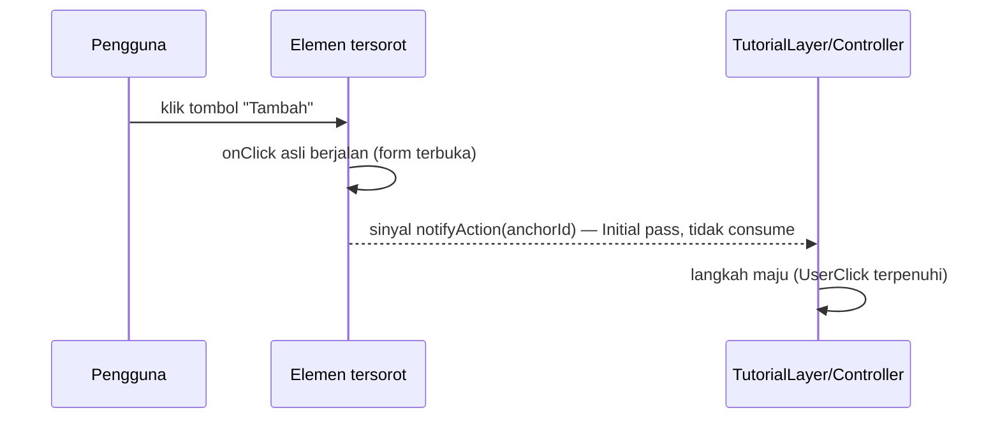

# TRD-TUT-002: Interactive Coach Mark — Spotlight Tembus & Langkah Beraksi

> **Keluarga `TUT`** — dokumen ini memperbaiki **mesin langkah** coach mark. Terkait:
> [`TRD-TUT-001`](TRD-TUT-001-tutorial-coverage.md) (cakupan isi & anchor per modul/pack),
> [`TRD-HELP-001`](TRD-HELP-001-module-tutorials.md) (mesin awal Fase 1–4), `PLAN-help-003` (kontrak cakupan).

## 0. Discovery Note (ringkas)

**Tanggal**: 2026-10-15 · **Penulis**: Achmad Jamaludin (dibantu Kilo)

### 0.1 Kebutuhan

- **Masalah nyata**: selama tutorial berjalan, layar **tidak bisa disentuh sama sekali**. `ClaySpotlightScrim`
  (`app/.../presentation/designsystem/ClaySpotlightScrim.kt`) digambar dengan `Canvas(fillMaxSize)` +
  `pointerInput { detectTapGestures { } }`, sehingga ia **menelan seluruh ketukan di layar** — bukan hanya di luar lubang sorot.
- **Akibat pada alur "cara menambah data"**: pengguna membuka daftar tabel, bertanya "cara menambah data", tutorial menyorot
  tombol **Tambah** — tetapi tombol itu **tidak bisa diklik**, jadi form yang ingin dilihat tidak pernah muncul. Pengguna harus
  menekan **Tutup** dulu, baru mengklik manual; langkah tutorial tidak ikut maju. Untuk tutorial yang mengajarkan *tindakan*,
  ini patah.
- Keputusan lama yang kini ditinjau: KDoc `ClaySpotlightScrim.kt:23` menyatakan *"Scrim menelan ketukan — selama tutorial,
  maju-mundur lewat callout, bukan lewat klik tembus"*. TRD ini menggantinya dengan model **opsional-per-langkah**.
- **Siapa memakai**: semua pengguna tenant yang menjalankan tutorial bertipe "beraksi" (bukan sekadar "membaca").
- **Kapan berubah**: saat kebutuhan tutorial bergeser dari sekadar memperkenalkan UI ke mengajarkan langkah kerja.

### 0.2 Fitur serupa

Perintah: `scripts/find-similar-feature.sh tutorial panduan bantuan help coachmark`
→ **sudah ada** mesinnya (`TutorialController`, `TutorialLayer`, `CoachMarkOverlay`, `ClaySpotlightScrim`).
**Keputusan: ubah mesin yang ada secara aditif** (mode baru + trigger baru), bukan fitur baru dan bukan tulis ulang.

### 0.3 Uji Variabilitas

| Konsep | Beda per tenant? | Per pack/industri? | Admin ubah? | → Kode / Data | Catatan |
|---|---|---|---|---|---|
| Mode sorot (tembus/blokir) per langkah | Tidak | Tidak | Tidak | **Kode** (`TutorialStep.advanceOn`/opsi langkah) | Perilaku sistem, bukan data tenant |
| `AdvanceTrigger` (Manual / UserClick / StateAppears) | Tidak | Tidak | Tidak | **Kode** (value object) | — |
| Geometri region scrim | Tidak | Tidak | Tidak | **Kode** (fungsi murni) | Diuji tanpa Compose |

### 0.4 Core & extend

- **Core (domain, kecil)**: `domain/tutorial/ModuleTutorial.kt` — tambah field pada `TutorialStep`.
- **Client (utama)**: `presentation/designsystem/ClaySpotlightScrim.kt`, `presentation/tutorial/{TutorialAnchor,TutorialLayer,CoachMarkOverlay}.kt`, `TutorialController`.
- **Titik extend**: implementasi region scrim, observasi tap tanpa consume, dan wiring trigger di `TutorialLayer`.
- **Tidak disentuh**: server (tanpa endpoint/perubahan API), `ModuleDefinition`, `DomainPackCodec`.

### 0.5 I/O & kanvas

Tidak ada port, tidak ada node kanvas, tidak ada telemetri. `POST /api/tenant/help/ask` tidak berubah.

### 0.6 Batas arsitektur yang harus dihormati

- **Dialog/popup berada di window terpisah** sehingga **tidak bisa** di-anchor maupun diklik-tembus (batasan HELP-001 §4.6).
  Langkah yang hasilnya adalah dialog tidak dapat memakai mode tembus; ia harus memakai `Manual` (lihat FR-5).
- Komponen `designsystem/` harus tetap **buta domain** (design-system Kontrak 6): menerima `Rect`/`Color`/lambda, bukan `ModuleTutorial`.

---

## 1. Document Context and Administration

- **Title & Unique ID**: TRD-TUT-002, Interactive Coach Mark — Spotlight Tembus & Langkah Beraksi
- **Revision History**:

| Versi | Tanggal | Penulis | Catatan |
|---|---|---|---|
| 0.1 | 2026-10-15 | Achmad Jamaludin / Kilo | Draf awal dari temuan "layar tidak interaktif selama tutorial" |

- **Summary & Business Context**:
  - Coach mark yang ada bagus untuk *membaca* UI, tetapi **tidak mendukung alur kerja**: pengguna tidak dapat menekan kontrol
    yang sedang disorot. Untuk pertanyaan seperti "cara menambah data", pengguna justru perlu membuka form — dan itu butuh klik.
  - TRD ini menambahkan **mode tembus** (klik asli sampai ke elemen yang disorot) plus **trigger kemajuan langkah**
    (`advanceOn`), secara **aditif dan opt-in per langkah** agar tutorial lama tidak berubah perilaku.
- **Stakeholders**:
  - Product: Achmad Jamaludin
  - Tech Lead: tim platform
  - QA: verifikasi visual + uji aksesibilitas (keyboard/Escape)
- **Goals (In-Scope)**:
  1. **Spotlight tembus**: area target tidak tertutup node penangkap ketukan, sehingga klik asli tembus ke elemen di bawahnya.
  2. **Trigger kemajuan**: `TutorialStep.advanceOn` = `Manual` | `UserClick(anchorId)` | `StateAppears(anchorId)`, default `Manual`.
  3. **Observasi tap tanpa membajak**: klik pada elemen tersorot tetap menjalankan handler aslinya sekaligus memberi sinyal ke tutorial.
  4. **Degradasi jujur**: bila elemen tidak dapat diklik atau berada di dialog, langkah jatuh ke `Manual` + callout `CENTER`.
  5. **Fokus tetap terjaga**: ketukan **di luar** target tetap diblokir supaya pengguna tidak salah klik.
- **Non-Goals (Out-of-Scope)**:
  - Tutorial yang **mengubah state aplikasi sendiri** (auto-open form/dialog). Tutorial tidak pernah menulis data atau membuka UI sendiri.
  - Menyorot atau mengklik-tembus elemen di dalam **dialog/popup** (window terpisah — batas arsitektur, bukan bug).
  - Mengganti scrim menjadi non-modal sepenuhnya (opsi "ring tanpa scrim") — dicatat sebagai **alternatif** di §4.5, bukan target TRD ini.
  - Perubahan server/API/skema.
  - Perubahan konten tutorial (itu `TRD-TUT-001`).

## 2. Functional Requirements

### FR-1 — Mode sorot tembus (pass-through)

`ClaySpotlightScrim` menerima opsi `interactive: Boolean` (default `false`, mempertahankan perilaku lama):

- **`interactive = false`** (perilaku sekarang): satu `Canvas` penuh dengan `pointerInput` menelan semua ketukan.
- **`interactive = true`**: scrim digambar sebagai **≤4 region persegi** yang mengelilingi target (atas, bawah, start, end).
  Area target **tidak tertutup node apa pun**, sehingga ketukan di area itu sampai ke elemen aplikasi di bawahnya.
  Setiap region tetap menelan ketukan di area gelap (fokus terjaga).

Geometri dihitung oleh **fungsi murni** yang dapat diuji tanpa Compose:

```kotlin
// presentation/designsystem — murni, tanpa Compose runtime
internal fun spotlightRegions(
    container: IntSize,
    target: Rect?,          // koordinat lokal overlay
    padding: Float,
    radius: Float,
): List<Rect>               // 0 region bila target == null (scrim penuh)
```

- Bila `target == null` → mode tembus **tidak berlaku** (scrim penuh; langkah tanpa anchor tetap `CENTER`).
- Region yang tingginya/lebarnya ≤ 0 karena target menyentuh tepi layar **dibuang**, bukan digambar.
- Lubang tetap diberi outline `Stroke(ClayBorder.Thick)` warna `WeMadeColors.Accent` (tampilan tidak berubah).

### FR-2 — `advanceOn`: trigger kemajuan langkah

`TutorialStep` mendapat field baru:

```kotlin
sealed interface AdvanceTrigger {
    data object Manual : AdvanceTrigger                       // default — perilaku lama (tombol Lanjut)
    data class UserClick(val anchorId: TutorialAnchorId) : AdvanceTrigger
    data class StateAppears(val anchorId: TutorialAnchorId) : AdvanceTrigger
}

data class TutorialStep(
    val title: String,
    val body: String,
    val anchor: TutorialAnchorId? = null,
    val screen: ModuleId? = null,
    val placement: CalloutPlacement = CalloutPlacement.BOTTOM,
    val interactive: Boolean = false,                          // FR-1
    val advanceOn: AdvanceTrigger = AdvanceTrigger.Manual,     // FR-2
)
```

- **Default `Manual`** ⇒ tutorial yang sudah ada berperilaku **identik** (kompatibel mundur, tanpa migrasi konten).
- `manual` tetap selalu tersedia sebagai jalan keluar: tombol **Lanjut** di callout tidak pernah dihapus.

### FR-3 — Observasi tap tanpa membajak handler asli

Agar `UserClick` dapat bekerja tanpa mengubah setiap tombol:

- `Modifier.tutorialAnchor(id)` diperluas: di samping melaporkan `boundsInWindow()`, ia **mengamati** event tap di
  `PointerEventPass.Initial` dan **tidak** meng-`consume()`-nya. Jadi `onClick` asli elemen tetap berjalan, dan
  `TutorialController.notifyAction(id)` dipanggil sebagai efek samping.
- Sinyal hanya berpengaruh bila langkah aktif memang `UserClick(id)` untuk anchor yang sama; di luar itu diabaikan.
- Elemen tanpa handler klik tetap boleh diberi anchor — sinyalnya hanya tidak akan pernah datang (lihat FR-5).

### FR-4 — `StateAppears`

- `StateAppears(anchorId)`: langkah maju ketika `TutorialAnchorRegistry` mulai memuat bounds untuk `anchorId`.
  Implementasi memakai `snapshotFlow { anchors.boundsOf(id) }.first { it != null }` — pola yang **sudah dipakai**
  `TutorialLayer` untuk menunggu anchor (batas `ANCHOR_WAIT_MS`).
- Cocok untuk langkah yang hasilnya bukan dialog (mis. panel muncul di layar yang sama).

### FR-5 — Degradasi jujur (tidak boleh dead-end)

Langkah maju **wajib** tetap bisa diselesaikan dalam keadaan apa pun:

| Kondisi | Perilaku |
|---|---|
| `target == null` (anchor tak terdaftar/tak muncul setelah 1,5 s) | `Manual` + callout `CENTER`; scrim penuh (mode tembus tidak berlaku) |
| Anchor ada tetapi elemennya tidak punya handler klik | `UserClick` tidak pernah datang → **callout menampilkan tombol "Lanjut"** sebagai fallback |
| Hasil langkah adalah **dialog** (tidak bisa di-anchor) | Wajib `Manual`; dilarang `StateAppears`/`UserClick` ke anchor dialog |
| Wewenang dicabut saat tutorial berjalan (ganti persona) | Tutorial dihentikan (mekanisme lama di `TutorialLayer`) |

- **Jaminan**: tidak ada langkah yang membuat pengguna terjebak tanpa cara maju atau menutup (tombol **Tutup** selalu ada).

### FR-6 — Fokus & keselamatan

- Ketukan di area gelap (di luar target) tetap tertelan → mencegah salah klik ke elemen lain.
- Callout selalu di atas scrim dan dapat dijangkau; `Tutup` selalu tersedia di semua langkah.
- Tutorial **tidak pernah** mengubah state aplikasi, membuka dialog, atau memanggil API tulis.

## 3. Non-Functional Requirements

| Category | Requirement & Target Metrics | Rationale / Mitigation |
| :--- | :--- | :--- |
| **Performance** | Region dihitung ulang hanya saat bounds target/ukuran kontainer berubah; overlay tetap 60 fps. | Hanya beberapa `Rect`; tidak ada alokasi per-frame di jalur gambar. |
| **Accessibility** | `Esc` = dismiss; tombol callout dapat difokus keyboard; maju-mundur tetap bisa tanpa klik elemen. | Mode tembus **tidak** boleh menjadi satu-satunya cara maju. |
| **Security** | Tidak ada permukaan baru; tidak ada API/data disentuh. | Perubahan murni UI. |
| **Availability & Reliability** | Setiap langkah punya jalan keluar (FR-5); tidak ada state tutorial yang menahan navigasi. | Degradasi anggun seperti desain awal (anchor hilang → `CENTER`). |
| **Maintainability & Observability** | Geometri region = fungsi murni yang diuji; `ClaySpotlightScrim` tetap buta domain (menerima `Rect`/`Color`/lambda). | Bug layout tak bisa ditutup test, jadi tetap wajib cek visual. |
| **Compatibility** | Default `interactive = false` + `advanceOn = Manual` ⇒ konten tutorial lama tidak berubah. | Tanpa migrasi konten; fitur opt-in per langkah. |
| **Design System** | Reuse `WeMadeColors.Scrim`/`Accent`, `ClayBorder.Thick`; **nol** literal warna baru di luar `WeMadeTheme.kt`. | design-system-rules Kontrak 1 & 8 (ketebalan konsisten, state lewat warna). |

## 4. System Architecture & Technical Design

### 4.1 High-Level

```mermaid
flowchart LR
  STEP[TutorialStep: interactive + advanceOn] --> LAYER[TutorialLayer]
  LAYER -->|mode tembus| SCRIM[ClaySpotlightScrim regions]
  LAYER -->|advanceOn| CTRL[TutorialController]
  ANCHOR[Modifier.tutorialAnchor] -->|bounds + tap observasi (tanpa consume)| REG[TutorialAnchorRegistry]
  REG --> LAYER
  ANCHOR --> CTRL
  SCRIM -.lubang tembus.-> APP[Elemen aplikasi di bawah]
```

Alur maju langkah:



### 4.2 Detailed Component Design

| Berkas | Perubahan |
|---|---|
| `core/.../domain/tutorial/ModuleTutorial.kt` | `TutorialStep` + `interactive`, `advanceOn`; tipe `AdvanceTrigger` (sealed interface) |
| `core/.../domain/tutorial/TutorialController.kt` (atau `presentation/tutorial/`) | `notifyAction(anchorId)` yang hanya berefek bila langkah aktif menunggu anchor itu |
| `presentation/designsystem/ClaySpotlightScrim.kt` | Opsi `interactive`; gambar ≤4 region; fungsi murni `spotlightRegions(...)`; KDoc diperbarui (keputusan lama dicabut) |
| `presentation/tutorial/TutorialAnchor.kt` | `Modifier.tutorialAnchor(id, onAction: ((TutorialAnchorId) -> Unit)? = null)` — observasi tap `PointerEventPass.Initial` tanpa consume |
| `presentation/tutorial/TutorialLayer.kt` | Wiring trigger: `UserClick` (dari `onAction`) dan `StateAppears` (`snapshotFlow`) → `controller.next()`; teruskan `interactive` ke overlay |
| `presentation/tutorial/CoachMarkOverlay.kt` | Teruskan `interactive` ke scrim; jaga callout tetap di atas & terjangkau |

### 4.3 Data Model

Tidak ada perubahan skema/DB. Perubahan hanya pada model in-memory `TutorialStep` (FR-2). Tidak ada serialisasi tutorial
(`DomainPackCodec` tidak disentuh) sehingga field baru tidak perlu codec.

### 4.4 API Specifications

**Tidak ada** endpoint/API berubah. Perubahan 100% klien + satu tipe domain.

### 4.5 Technology Usage & Tradeoff

| Pilihan | Alternatif | Alasan |
|---|---|---|
| **Region tembus (≤4 kotak)** | Scrim penuh + `pointerInput` kustom dengan hit-test manual | Compose menghitung hit-test per-node; node tidak bisa "menolak" area tertentu. Memecah region = cara paling lugas & lintas-target, tanpa API platform |
| **Observasi tap di `Initial` pass** | Menambah `onClick` ke setiap tombol | Menambah handler di 10+ layar = melanggar Aturan Tiga Kali & rapuh terhadap refactor |
| **`StateAppears` sebagai default untuk alur** | Hanya `UserClick` | `StateAppears` tidak bergantung pada klik persis (tahan perubahan UI) dan bekerja di kasus tanpa handler klik |
| **Non-modal penuh (tanpa scrim)** | Dicatat sebagai alternatif | Kehilangan fokus & callout mudah menutupi elemen; bukan target TRD ini |
| **Opt-in per langkah (`Manual` default)** | Mengubah semua tutorial sekaligus | Menjaga kompatibilitas; tiap langkah memutuskan apakah ia "membaca" atau "beraksi" |

### 4.6 Assumptions, Constraints, Dependencies

- **Asumsi**: elemen yang disorot berada di window yang sama dengan `TutorialLayer` (root `App`), sesuai desain anchor.
- **Batasan**: dialog/popup tidak dapat di-anchor maupun ditembus (window berbeda).
- **Dependensi**: `TRD-TUT-001` (anchor per modul harus ada agar `UserClick`/`StateAppears` bisa dipakai); `TRD-HELP-001` (mesin).
- **Dampak dokumentasi**: keputusan "scrim menelan ketukan" dicabut ⇒ KDoc `ClaySpotlightScrim` dan TRD-HELP-001 §FR-3/§4.6 perlu catatan revisi
  (doc-drift yang harus diselesaikan di PR yang sama).

## 5. Testing, Deployment, and Operations

### Effort Estimation & Reasoning

- **Rating**: **Medium**
- **Reasoning**: satu tipe domain kecil + 4–5 berkas klien; **tanpa** server, migrasi, atau agregat baru. Kompleksitasnya
  bukan volume, melainkan perilaku pointer (hit-test tembus) dan penjagaan agar tidak ada langkah yang dead-end — karena itu
  geometri dijadikan fungsi murni dan degradasi diuji eksplisit.

### Parallel Execution Plan (Tracks)

**Track 0 — Contract Phase (Serial, prasyarat)**
1. Bekukan `AdvanceTrigger` + field `TutorialStep.interactive`/`advanceOn` (default `Manual`).
2. Bekukan signature fungsi murni `spotlightRegions(container, target, padding, radius): List<Rect>`.
3. Bekukan semantik `notifyAction(anchorId)` (hanya berefek pada langkah `UserClick` yang cocok).
4. Bekukan tabel degradasi FR-5 sebagai fixture test.

**Track A — Core (coding)**: `TutorialStep` + `AdvanceTrigger`; `TutorialController.notifyAction`; test state machine.

**Track B — Client (coding)**: `spotlightRegions` + `ClaySpotlightScrim.interactive`; `tutorialAnchor(...)` observasi `Initial`
pass tanpa consume; wiring `TutorialLayer` (`UserClick`/`StateAppears`); teruskan `interactive` di `CoachMarkOverlay`.

**Track C — Verification (visual & a11y)**: kompilasi 5 target; cek visual tembus pada satu langkah nyata; verifikasi klik
di luar target tetap diblokir; uji `Esc` & fokus callout; audit design-system (nol literal warna baru) & `wc -l` berkas tersentuh.
**Tidak ada Track server.**

### Technical Acceptance Criteria

1. Langkah bertanda "beraksi" (mis. menyorot tombol **Tambah**) membuka form **saat tombol itu diklik** — tanpa menutup tutorial.
2. Klik **di luar** target tetap diblokir; pengguna tidak bisa menyentuh UI lain selama langkah berjalan.
3. Tutorial lama (tanpa `interactive`/`advanceOn`) **berperilaku identik** — regresi nol pada konten yang sudah ada.
4. Langkah yang hasilnya dialog memakai `Manual` dan tetap bisa diselesaikan (tidak dead-end).
5. Anchor tanpa handler klik: `UserClick` tidak pernah datang, dan tombol **Lanjut** tetap tampil sebagai fallback.
6. `Esc` menutup tutorial; tombol callout dapat difokus keyboard.
7. Kompilasi 5 target hijau; nol literal warna baru di luar `WeMadeTheme.kt`; cek visual dengan mata.

### Testing Strategy

| Lapisan | Test |
|---|---|
| `core/commonTest` | `TutorialStep`/`AdvanceTrigger` default; `TutorialController.notifyAction` (hanya anchor yang cocok memajukan; `Manual` tak terpengaruh) |
| `core/commonTest` (murni) | `spotlightRegions`: target di tengah, menyentuh tepi, target lebih besar dari kontainer, `target == null` (0 region) |
| `app/shared/commonTest` | Wiring `TutorialLayer` (fake registry) untuk `StateAppears` & `UserClick`; degradasi FR-5 |
| Build | Kompilasi 5 target |
| Visual (wajib) | Satu langkah nyata di `wemade-demo`: klik tembus membuka form; klik luar diblokir — **bug hit-test tidak tertangkap test** |

### Monitoring & Error Handling

- Tidak ada log baru yang membawa data pengguna. Bila `UserClick` tidak pernah datang dalam langkah, tidak ada error —
  callout tetap menampilkan tombol **Lanjut** (degradasi, bukan kegagalan).

### Deployment & Rollback Plan

- **Opt-in per langkah**: tutorial lama tidak berubah; tidak butuh flag server.
- **Bertahap**: Track A+B bisa di-merge sebelum konten langkah-langkah "beraksi" ditulis di `TRD-TUT-001`.
- **Rollback**: revert commit. Karena tidak ada migrasi/data, rollback tidak meninggalkan sisa.
